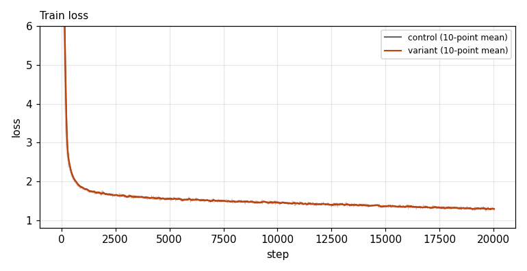
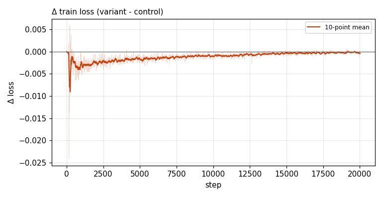

# X0237 · lm_head rows as MLA value embeddings · competitive-d1280 · noise

Trial t005 · commit `609dac681c` · [#9514 comment](https://github.com/marin-community/marin/issues/9514#issuecomment-6958960102) · approved by @armorfaye (trusted)

## Final eval

| Run | Paloma macro loss | Δ vs control | Paloma macro BPB |
|---|---|---|---|
| s7n-d1280L16 | 2.2706 |  | 0.9459 |
| belay-X0237d1280-seed0 | 2.2711 | +0.0005 | 0.9462 |

Rule: Δ ≤ −0.005 win · ≥ +0.005 loss · otherwise noise. Verdict on loss; BPB (byte-weighted) shown for reference.

## Train loss

## Δ train loss

## Speed (median after step 5)

| Run | s/step | tokens/s |
|---|---|---|
| s7n-d1280L16 | 2.8259 | 1484215 |
| belay-X0237d1280-seed0 | 2.8284 | 1482907 |

## MoE routing: capacity drops (mean over layers)

| Control | Variant |
|---|---|
| 0.000212 | 0.000201 |

## MoE routing: router bias max

| Control | Variant |
|---|---|
| 1.905005 | 2.001455 |

## Gradient norm

| Control | Variant |
|---|---|
| 0.271355 | 0.277181 |
