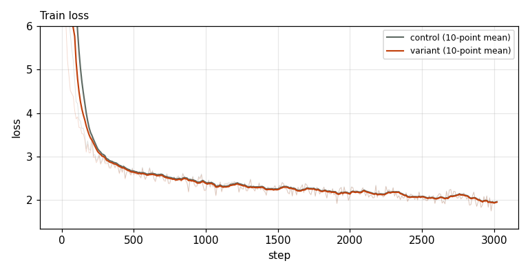
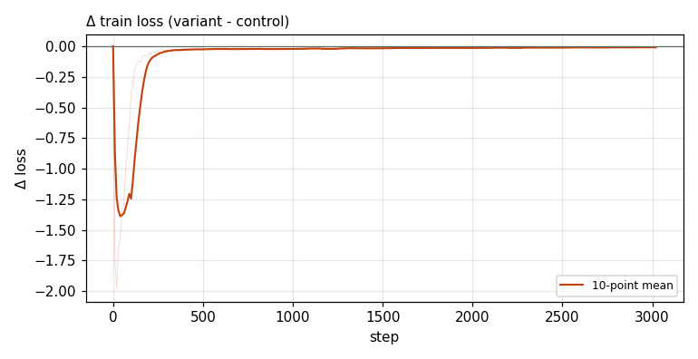

# X0238 · Exact-match pointer mixture on the output · speedrun · win

Trial t001 · commit `3400b535db` · [#9514 comment](https://github.com/marin-community/marin/issues/9514#issuecomment-6959043400) · approved by @armorfaye (trusted)

## Final eval

| Run | Paloma macro loss | Δ vs control | Paloma macro BPB |
|---|---|---|---|
| belay-X0238-control | 3.0452 |  | 1.2595 |
| belay-X0238-seed0 | 3.0329 | -0.0123 | 1.2546 |

Rule: Δ ≤ −0.005 win · ≥ +0.005 loss · otherwise noise. Verdict on loss; BPB (byte-weighted) shown for reference. The final speedrun verdict is the equal-time verdict.

## Train loss

## Δ train loss

## Speed (median after step 5)

| Run | s/step | tokens/s |
|---|---|---|
| belay-X0238-control | 0.1584 | 3309336 |
| belay-X0238-seed0 | 0.1601 | 3274706 |

## MoE routing: capacity drops (mean over layers)

| Control | Variant |
|---|---|
| 0.000892 | 0.001079 |

## MoE routing: router bias max

| Control | Variant |
|---|---|
| 1.979469 | 1.907257 |

## Gradient norm

| Control | Variant |
|---|---|
| 0.305365 | 0.274519 |
