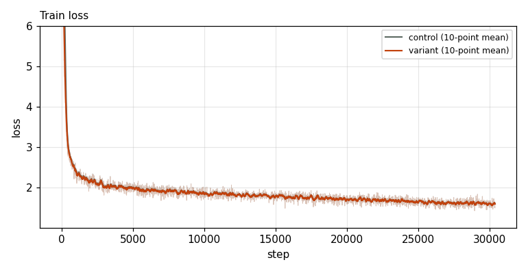
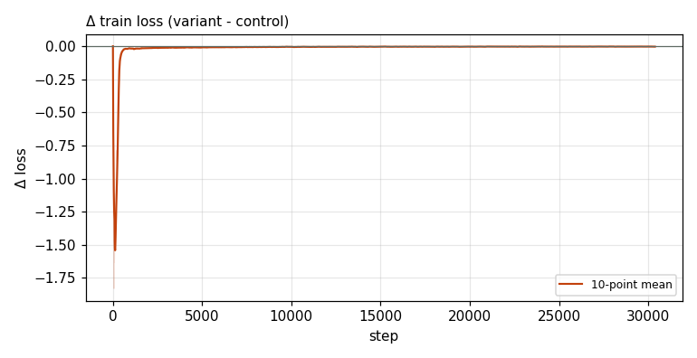

# X0238 · Exact-match pointer mixture on the output · competitive-d768 · noise

Trial t004 · commit `3779f981d8` · [#9514 comment](https://github.com/marin-community/marin/issues/9514#issuecomment-6963691224) · approved by @armorfaye (trusted)

## Final eval

| Run | Paloma macro loss | Δ vs control | Paloma macro BPB |
|---|---|---|---|
| s7n-d768 | 2.6121 |  | 1.0839 |
| belay-X0238d768-seed0 | 2.6077 | -0.0044 | 1.0822 |

Rule: Δ ≤ −0.005 win · ≥ +0.005 loss · otherwise noise. Verdict on loss; BPB (byte-weighted) shown for reference.

## Train loss

## Δ train loss

## Speed (median after step 5)

| Run | s/step | tokens/s |
|---|---|---|
| s7n-d768 | 0.3829 | 1369129 |
| belay-X0238d768-seed0 | 0.3816 | 1374088 |

## MoE routing: capacity drops (mean over layers)

| Control | Variant |
|---|---|
| 0.000783 | 0.000819 |

## MoE routing: router bias max

| Control | Variant |
|---|---|
| 1.490199 | 1.540342 |

## Gradient norm

| Control | Variant |
|---|---|
| 0.316863 | 0.298277 |
