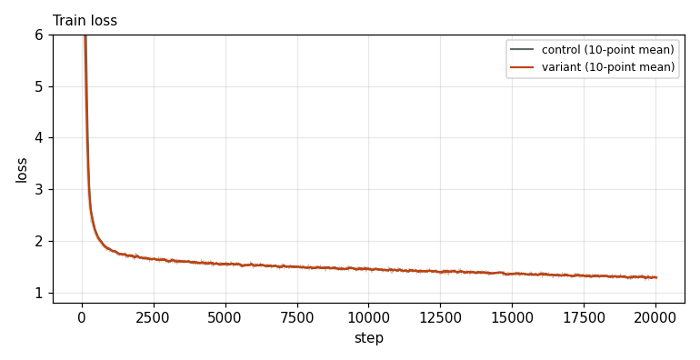
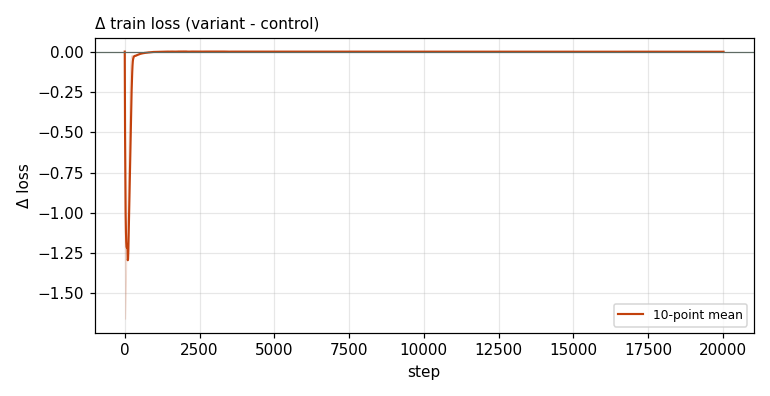

# X0238 · Exact-match pointer mixture on the output · competitive-d1280 · noise

Trial t006 · commit `c4e16839c5` · [#9514 comment](https://github.com/marin-community/marin/issues/9514#issuecomment-6963691224) · approved by @armorfaye (trusted)

## Final eval

| Run | Paloma macro loss | Δ vs control | Paloma macro BPB |
|---|---|---|---|
| s7n-d1280L16 | 2.2706 |  | 0.9459 |
| belay-X0238d1280-seed0 | 2.2706 | +0.0000 | 0.9460 |

Rule: Δ ≤ −0.005 win · ≥ +0.005 loss · otherwise noise. Verdict on loss; BPB (byte-weighted) shown for reference.

## Train loss

## Δ train loss

## Speed (median after step 5)

| Run | s/step | tokens/s |
|---|---|---|
| s7n-d1280L16 | 2.8259 | 1484215 |
| belay-X0238d1280-seed0 | 2.8275 | 1483389 |

## MoE routing: capacity drops (mean over layers)

| Control | Variant |
|---|---|
| 0.000212 | 0.000215 |

## MoE routing: router bias max

| Control | Variant |
|---|---|
| 1.905005 | 1.671572 |

## Gradient norm

| Control | Variant |
|---|---|
| 0.271355 | 0.260122 |
