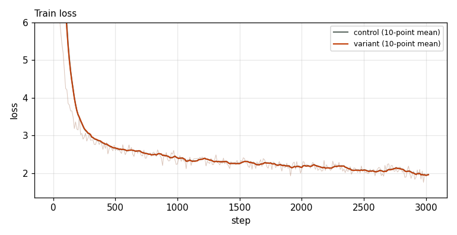
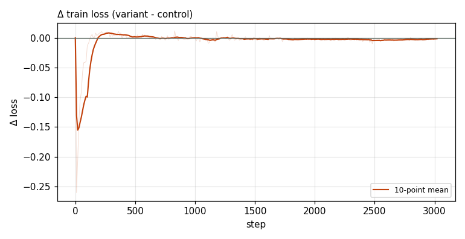

# X0239 · Input token embedding at 4x Adam LR · speedrun · noise

Trial t001 · commit `e71120947b` · [#9514 comment](https://github.com/marin-community/marin/issues/9514#issuecomment-6959048333) · approved by @armorfaye (trusted)

## Final eval

| Run | Paloma macro loss | Δ vs control | Paloma macro BPB |
|---|---|---|---|
| belay-X0239-control | 3.0457 |  | 1.2598 |
| belay-X0239-seed0 | 3.0427 | -0.0030 | 1.2584 |

Rule: Δ ≤ −0.005 win · ≥ +0.005 loss · otherwise noise. Verdict on loss; BPB (byte-weighted) shown for reference. The final speedrun verdict is the equal-time verdict.

## Train loss

## Δ train loss

## Speed (median after step 5)

| Run | s/step | tokens/s |
|---|---|---|
| belay-X0239-control | 0.1589 | 3299544 |
| belay-X0239-seed0 | 0.1592 | 3292708 |

## MoE routing: capacity drops (mean over layers)

| Control | Variant |
|---|---|
| 0.000772 | 0.001079 |

## MoE routing: router bias max

| Control | Variant |
|---|---|
| 1.922056 | 1.957237 |

## Gradient norm

| Control | Variant |
|---|---|
| 0.314197 | 0.297526 |
