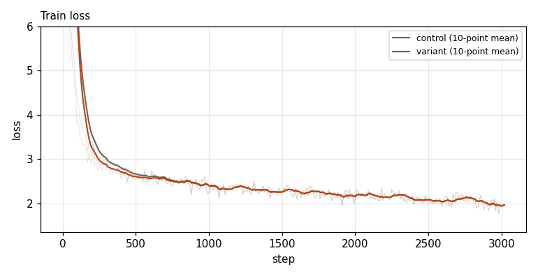
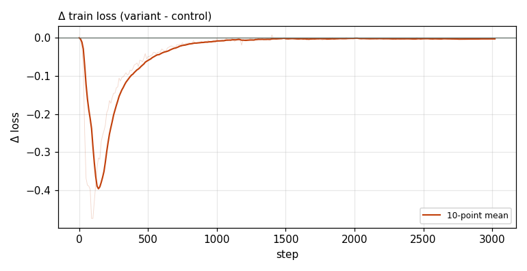

# X0240 · Softcap radial MuonH · speedrun · win

Trial t001 · commit `97213b778f` · [#9514 comment](https://github.com/marin-community/marin/issues/9514#issuecomment-6968062224) · approved by @WhenWen (trusted)

## Final eval

| Run | Paloma macro loss | Δ vs control | Paloma macro BPB |
|---|---|---|---|
| belay-X0240-control | 3.0463 |  | 1.2599 |
| belay-X0240-seed0 | 3.0379 | -0.0084 | 1.2565 |

Rule: Δ ≤ −0.005 win · ≥ +0.005 loss · otherwise noise. Verdict on loss; BPB (byte-weighted) shown for reference. The final speedrun verdict is the equal-time verdict.

## Train loss

## Δ train loss

## Speed (median after step 5)

| Run | s/step | tokens/s |
|---|---|---|
| belay-X0240-control | 0.1589 | 3299830 |
| belay-X0240-seed0 | 0.1588 | 3301291 |

## MoE routing: capacity drops (mean over layers)

| Control | Variant |
|---|---|
| 0.000904 | 0.000849 |

## MoE routing: router bias max

| Control | Variant |
|---|---|
| 1.786574 | 2.095807 |

## Gradient norm

| Control | Variant |
|---|---|
| 0.307215 | 0.277901 |
