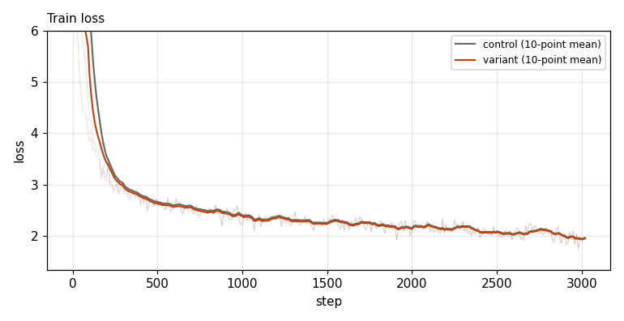
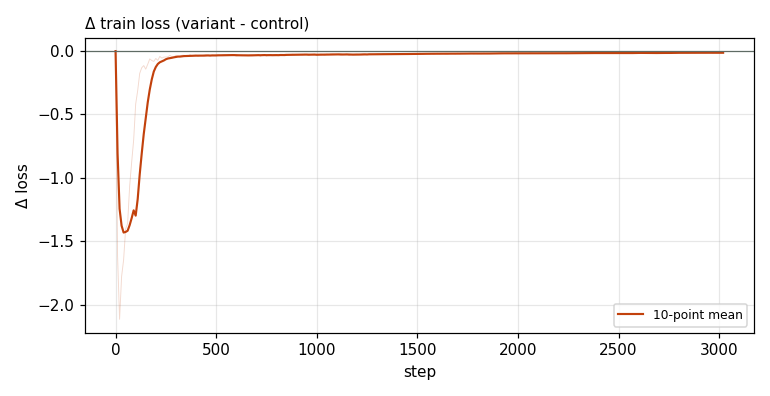

# X0242 · Document n-gram count cache mixture · speedrun · win

Trial t001 · commit `6909b71dbb` · [#9514 comment](https://github.com/marin-community/marin/issues/9514#issuecomment-6972547895) · approved by @armorfaye (trusted)

## Final eval

| Run | Paloma macro loss | Δ vs control | Paloma macro BPB |
|---|---|---|---|
| belay-X0242-control | 3.0460 |  | 1.2598 |
| belay-X0242-seed0 | 3.0248 | -0.0212 | 1.2513 |

Rule: Δ ≤ −0.005 win · ≥ +0.005 loss · otherwise noise. Verdict on loss; BPB (byte-weighted) shown for reference. The final speedrun verdict is the equal-time verdict.

## Train loss

## Δ train loss

## Speed (median after step 5)

| Run | s/step | tokens/s |
|---|---|---|
| belay-X0242-control | 0.1599 | 3278792 |
| belay-X0242-seed0 | 0.1609 | 3257870 |

## MoE routing: capacity drops (mean over layers)

| Control | Variant |
|---|---|
| 0.000832 | 0.001124 |

## MoE routing: router bias max

| Control | Variant |
|---|---|
| 1.874311 | 1.778701 |

## Gradient norm

| Control | Variant |
|---|---|
| 0.310571 | 0.281294 |
