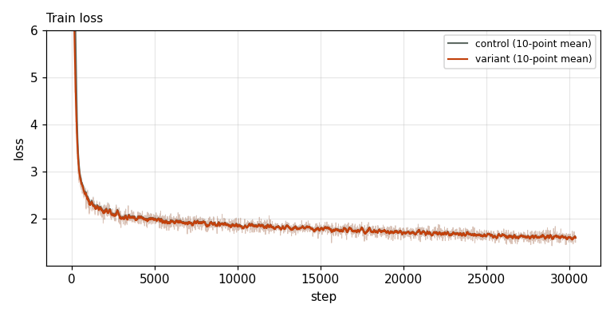
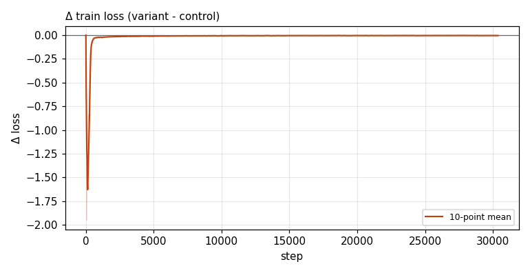

# X0242 · Document n-gram count cache mixture · competitive-d768 · noise

Trial t003 · commit `72e4fce9c4` · [#9514 comment](https://github.com/marin-community/marin/issues/9514#issuecomment-6986705008) · approved by @armorfaye (trusted)

## Final eval

| Run | Paloma macro loss | Δ vs control | Paloma macro BPB |
|---|---|---|---|
| s7n-d768 | 2.6121 |  | 1.0839 |
| belay-X0242d768-seed0-r1 | 2.6075 | -0.0046 | 1.0820 |

Rule: Δ ≤ −0.005 win · ≥ +0.005 loss · otherwise noise. Verdict on loss; BPB (byte-weighted) shown for reference.

## Train loss

## Δ train loss

## Speed (median after step 5)

| Run | s/step | tokens/s |
|---|---|---|
| s7n-d768 | 0.3829 | 1369129 |
| belay-X0242d768-seed0-r1 | 0.3816 | 1373918 |

## MoE routing: capacity drops (mean over layers)

| Control | Variant |
|---|---|
| 0.000783 | 0.000776 |

## MoE routing: router bias max

| Control | Variant |
|---|---|
| 1.490199 | 1.444170 |

## Gradient norm

| Control | Variant |
|---|---|
| 0.316863 | 0.293806 |
