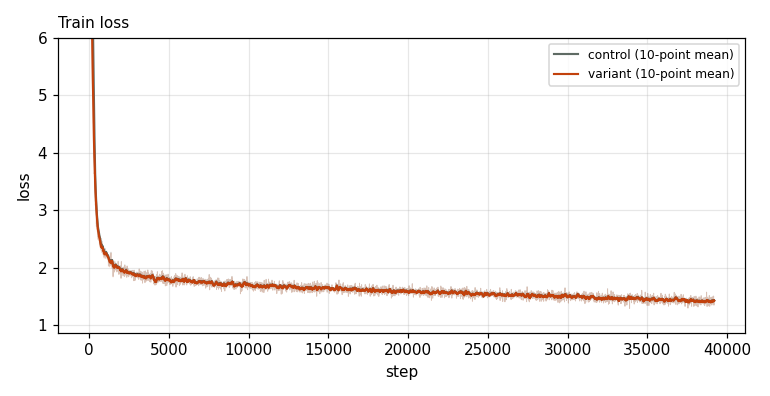
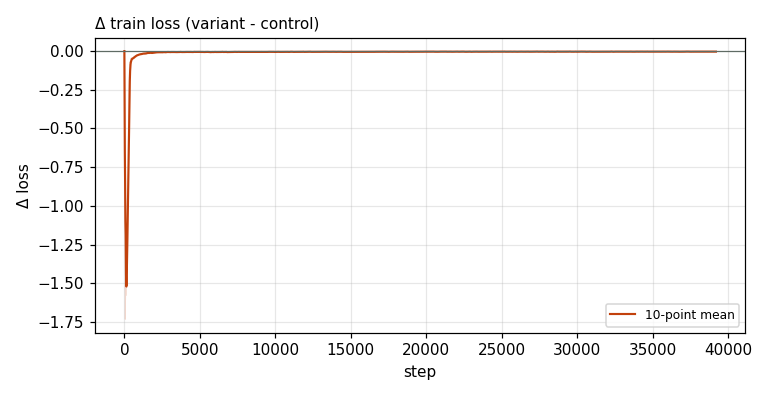

# X0242 · Document n-gram count cache mixture · competitive-d1024 · win

Trial t004 · commit `1e60428b9e` · [#9514 comment](https://github.com/marin-community/marin/issues/9514#issuecomment-6986705008) · approved by @armorfaye (trusted)

## Final eval

| Run | Paloma macro loss | Δ vs control | Paloma macro BPB |
|---|---|---|---|
| s7n-d1024 | 2.4106 |  | 1.0024 |
| belay-X0242d1024-seed0 | 2.4052 | -0.0054 | 1.0003 |

Rule: Δ ≤ −0.005 win · ≥ +0.005 loss · otherwise noise. Verdict on loss; BPB (byte-weighted) shown for reference.

## Train loss

## Δ train loss

## Speed (median after step 5)

| Run | s/step | tokens/s |
|---|---|---|
| s7n-d1024 | 1.4269 | 734858 |
| belay-X0242d1024-seed0 | 1.4250 | 735867 |

## MoE routing: capacity drops (mean over layers)

| Control | Variant |
|---|---|
| 0.000189 | 0.000224 |

## MoE routing: router bias max

| Control | Variant |
|---|---|
| 1.529888 | 1.615193 |

## Gradient norm

| Control | Variant |
|---|---|
| 0.219474 | 0.218603 |
