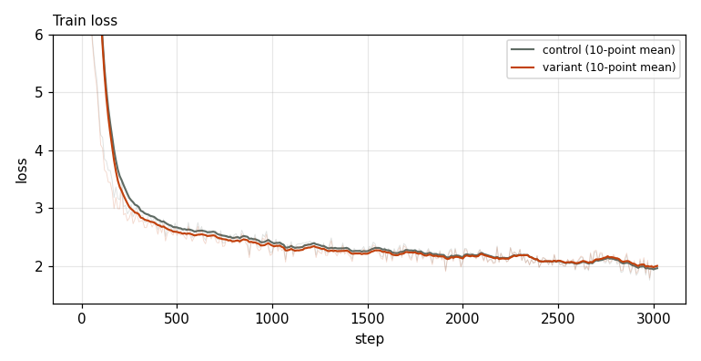
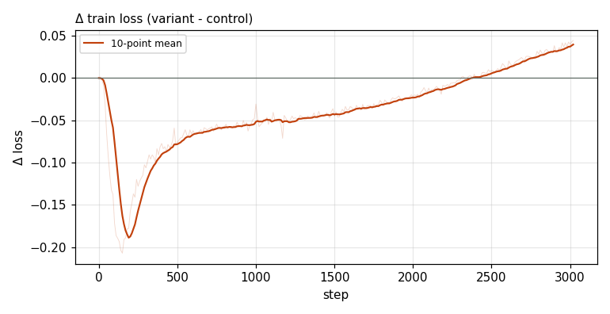

# X0243 · MuonC: Muon with AdamC-corrected weight decay · speedrun · loss

Trial t001 · commit `ee7cfd9913` · [#9514 comment](https://github.com/marin-community/marin/issues/9514#issuecomment-6974283352) · approved by @armorfaye (trusted)

## Final eval

| Run | Paloma macro loss | Δ vs control | Paloma macro BPB |
|---|---|---|---|
| belay-X0243-control | 3.0432 |  | 1.2587 |
| belay-X0243-seed0 | 3.0878 | +0.0445 | 1.2767 |

Rule: Δ ≤ −0.005 win · ≥ +0.005 loss · otherwise noise. Verdict on loss; BPB (byte-weighted) shown for reference. The final speedrun verdict is the equal-time verdict.

## Train loss

## Δ train loss

## Speed (median after step 5)

| Run | s/step | tokens/s |
|---|---|---|
| belay-X0243-control | 0.1584 | 3309485 |
| belay-X0243-seed0 | 0.1573 | 3334091 |

## MoE routing: capacity drops (mean over layers)

| Control | Variant |
|---|---|
| 0.000832 | 0.000783 |

## MoE routing: router bias max

| Control | Variant |
|---|---|
| 2.254920 | 1.639780 |

## Gradient norm

| Control | Variant |
|---|---|
| 0.310022 | 0.164419 |
