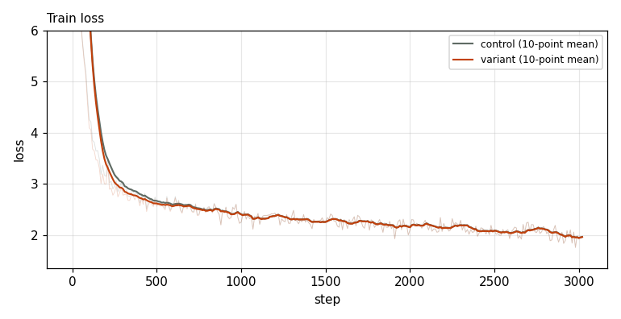
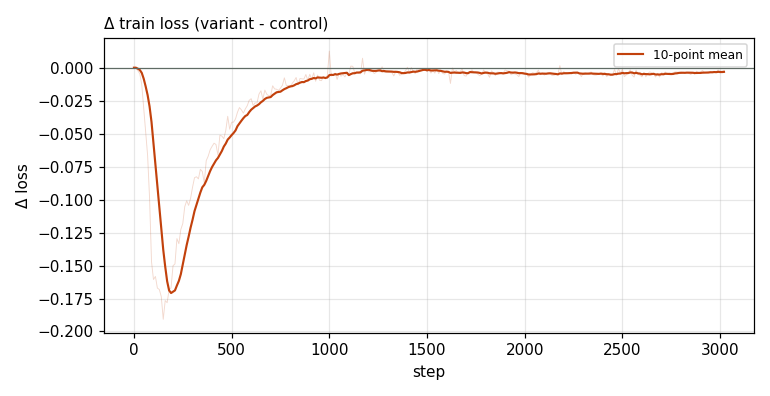

# X0244 · MuonC with 25x stronger decay · speedrun · win

Trial t001 · commit `6e4ec44a21` · [#9514 comment](https://github.com/marin-community/marin/issues/9514#issuecomment-6995649952) · approved by @armorfaye (trusted)

## Final eval

| Run | Paloma macro loss | Δ vs control | Paloma macro BPB |
|---|---|---|---|
| belay-X0244-control | 3.0460 |  | 1.2597 |
| belay-X0244-seed0 | 3.0392 | -0.0069 | 1.2570 |

Rule: Δ ≤ −0.005 win · ≥ +0.005 loss · otherwise noise. Verdict on loss; BPB (byte-weighted) shown for reference. The final speedrun verdict is the equal-time verdict.

## Train loss

## Δ train loss

## Speed (median after step 5)

| Run | s/step | tokens/s |
|---|---|---|
| belay-X0244-control | 0.1597 | 3283907 |
| belay-X0244-seed0 | 0.1583 | 3311260 |

## MoE routing: capacity drops (mean over layers)

| Control | Variant |
|---|---|
| 0.000785 | 0.000737 |

## MoE routing: router bias max

| Control | Variant |
|---|---|
| 1.813512 | 2.477745 |

## Gradient norm

| Control | Variant |
|---|---|
| 0.306966 | 0.287250 |
