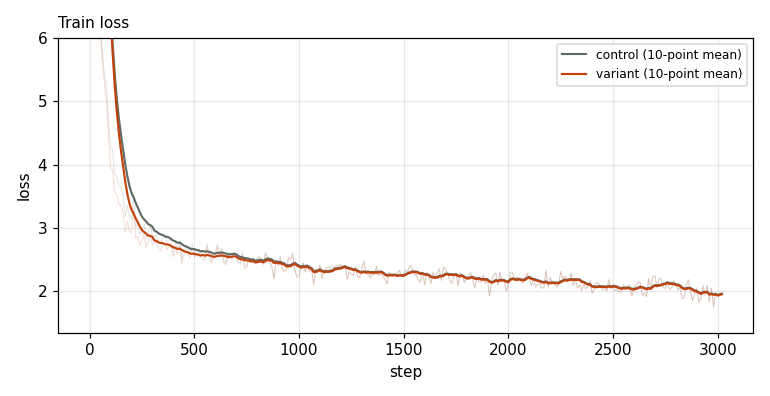
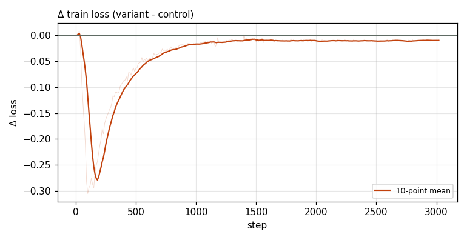

# X0245 · AdamC decay on head, router and embeddings · speedrun · win

Trial t001 · commit `4f1f3d92dd` · [#9514 comment](https://github.com/marin-community/marin/issues/9514#issuecomment-6998574819) · approved by @armorfaye (trusted)

## Final eval

| Run | Paloma macro loss | Δ vs control | Paloma macro BPB |
|---|---|---|---|
| belay-X0245-control | 3.0451 |  | 1.2593 |
| belay-X0245-seed0 | 3.0347 | -0.0104 | 1.2552 |

Rule: Δ ≤ −0.005 win · ≥ +0.005 loss · otherwise noise. Verdict on loss; BPB (byte-weighted) shown for reference. The final speedrun verdict is the equal-time verdict.

## Train loss

## Δ train loss

## Speed (median after step 5)

| Run | s/step | tokens/s |
|---|---|---|
| belay-X0245-control | 0.1587 | 3302662 |
| belay-X0245-seed0 | 0.1577 | 3325350 |

## MoE routing: capacity drops (mean over layers)

| Control | Variant |
|---|---|
| 0.000793 | 0.000862 |

## MoE routing: router bias max

| Control | Variant |
|---|---|
| 1.922512 | 1.734962 |

## Gradient norm

| Control | Variant |
|---|---|
| 0.312073 | 0.275714 |
