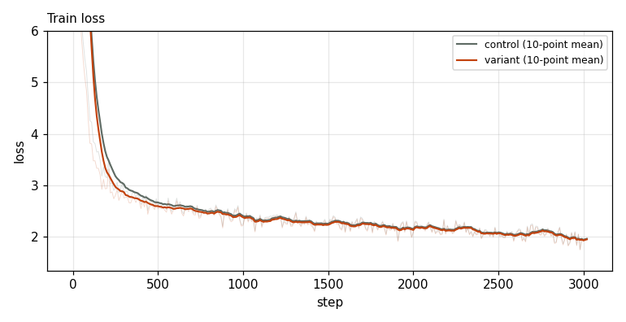
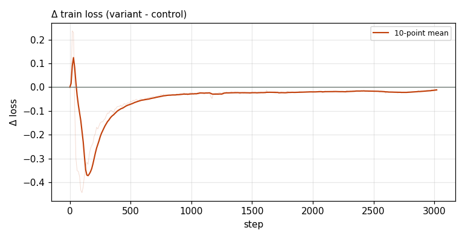

# X0246 · Learned-radius MuonH with s² anneals · speedrun · win

Trial t001 · commit `23af42aad2` · [#9514 comment](https://github.com/marin-community/marin/issues/9514#issuecomment-7019355085) · approved by @WhenWen (trusted)

## Final eval

| Run | Paloma macro loss | Δ vs control | Paloma macro BPB |
|---|---|---|---|
| belay-X0246-control | 3.0460 |  | 1.2598 |
| belay-X0246-seed0 | 3.0342 | -0.0118 | 1.2548 |

Rule: Δ ≤ −0.005 win · ≥ +0.005 loss · otherwise noise. Verdict on loss; BPB (byte-weighted) shown for reference. The final speedrun verdict is the equal-time verdict.

## Train loss

## Δ train loss

## Speed (median after step 5)

| Run | s/step | tokens/s |
|---|---|---|
| belay-X0246-control | 0.1587 | 3302870 |
| belay-X0246-seed0 | 0.1582 | 3314442 |

## MoE routing: capacity drops (mean over layers)

| Control | Variant |
|---|---|
| 0.000857 | 0.000835 |

## MoE routing: router bias max

| Control | Variant |
|---|---|
| 1.945537 | 1.903957 |

## Gradient norm

| Control | Variant |
|---|---|
| 0.312002 | 0.277803 |
