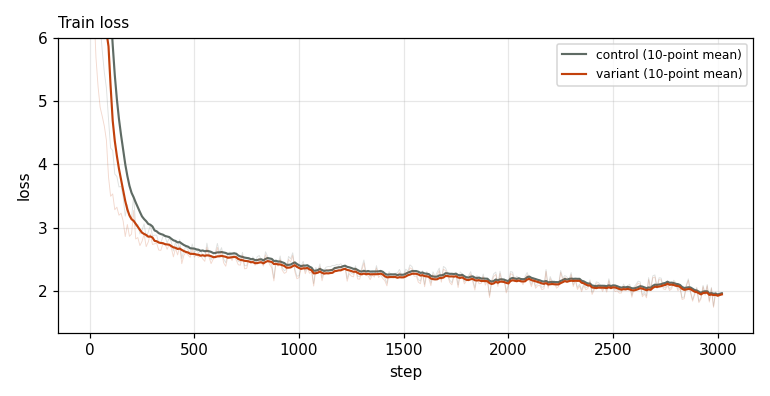
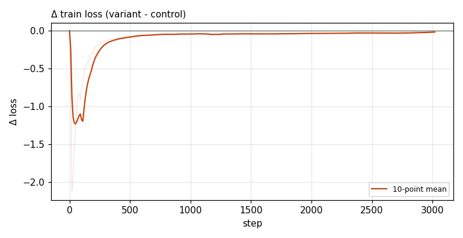

# X0247 · MuonC with s² head and late-matrix anneal · speedrun · win

Trial t001 · commit `760dbc5325` · [#9514 comment](https://github.com/marin-community/marin/issues/9514#issuecomment-7019433555) · approved by @WhenWen (trusted)

## Final eval

| Run | Paloma macro loss | Δ vs control | Paloma macro BPB |
|---|---|---|---|
| belay-X0247-control | 3.0458 |  | 1.2597 |
| belay-X0247-seed0 | 3.0314 | -0.0144 | 1.2538 |

Rule: Δ ≤ −0.005 win · ≥ +0.005 loss · otherwise noise. Verdict on loss; BPB (byte-weighted) shown for reference. The final speedrun verdict is the equal-time verdict.

## Train loss

## Δ train loss

## Speed (median after step 5)

| Run | s/step | tokens/s |
|---|---|---|
| belay-X0247-control | 0.1586 | 3306438 |
| belay-X0247-seed0 | 0.1583 | 3311732 |

## MoE routing: capacity drops (mean over layers)

| Control | Variant |
|---|---|
| 0.000870 | 0.001628 |

## MoE routing: router bias max

| Control | Variant |
|---|---|
| 1.895506 | 1.899621 |

## Gradient norm

| Control | Variant |
|---|---|
| 0.310228 | 0.150522 |
