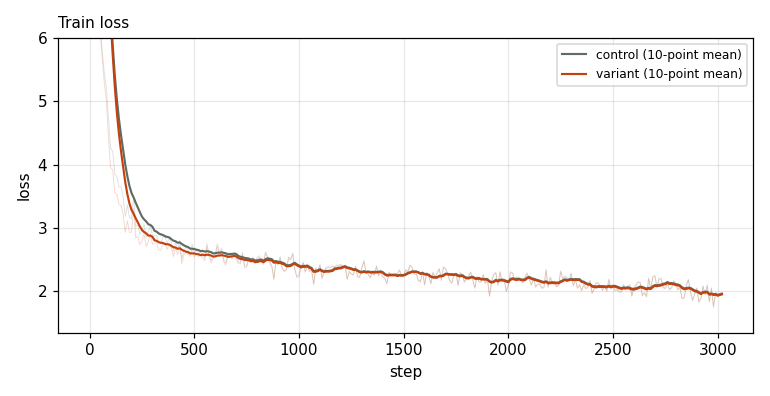
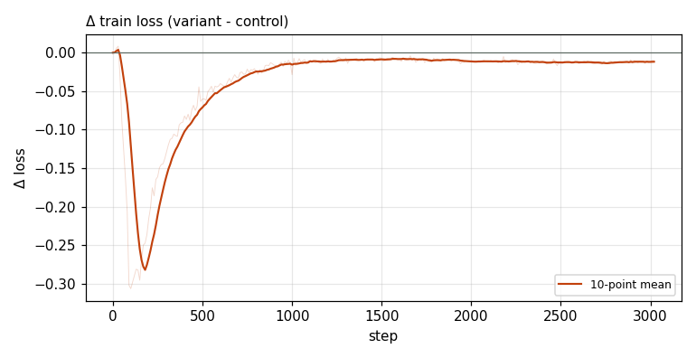

# X0248 · AdamC router/embed decay 0.3 · speedrun · win

Trial t001 · commit `33c8015240` · [#9514 comment](https://github.com/marin-community/marin/issues/9514#issuecomment-7020794352) · approved by @armorfaye (trusted)

## Final eval

| Run | Paloma macro loss | Δ vs control | Paloma macro BPB |
|---|---|---|---|
| belay-X0248-control | 3.0448 |  | 1.2592 |
| belay-X0248-seed0 | 3.0325 | -0.0122 | 1.2544 |

Rule: Δ ≤ −0.005 win · ≥ +0.005 loss · otherwise noise. Verdict on loss; BPB (byte-weighted) shown for reference. The final speedrun verdict is the equal-time verdict.

## Train loss

## Δ train loss

## Speed (median after step 5)

| Run | s/step | tokens/s |
|---|---|---|
| belay-X0248-control | 0.1585 | 3308056 |
| belay-X0248-seed0 | 0.1573 | 3332185 |

## MoE routing: capacity drops (mean over layers)

| Control | Variant |
|---|---|
| 0.000864 | 0.000980 |

## MoE routing: router bias max

| Control | Variant |
|---|---|
| 1.862299 | 1.762397 |

## Gradient norm

| Control | Variant |
|---|---|
| 0.312023 | 0.270722 |
