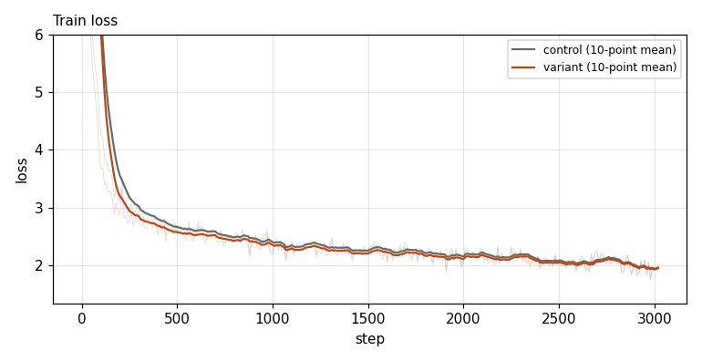
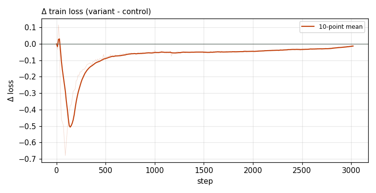

# X0249 · MuonC anneal 0.15 + AdamC head/router/embed · speedrun · win

Trial t001 · commit `744f10495b` · [#9514 comment](https://github.com/marin-community/marin/issues/9514#issuecomment-7022075928) · approved by @armorfaye (trusted)

## Final eval

| Run | Paloma macro loss | Δ vs control | Paloma macro BPB |
|---|---|---|---|
| belay-X0249-control | 3.0449 |  | 1.2593 |
| belay-X0249-seed0 | 3.0317 | -0.0132 | 1.2539 |

Rule: Δ ≤ −0.005 win · ≥ +0.005 loss · otherwise noise. Verdict on loss; BPB (byte-weighted) shown for reference. The final speedrun verdict is the equal-time verdict.

## Train loss

## Δ train loss

## Speed (median after step 5)

| Run | s/step | tokens/s |
|---|---|---|
| belay-X0249-control | 0.1592 | 3294057 |
| belay-X0249-seed0 | 0.1581 | 3316855 |

## MoE routing: capacity drops (mean over layers)

| Control | Variant |
|---|---|
| 0.000861 | 0.001260 |

## MoE routing: router bias max

| Control | Variant |
|---|---|
| 1.841485 | 2.341384 |

## Gradient norm

| Control | Variant |
|---|---|
| 0.303683 | 0.169643 |
