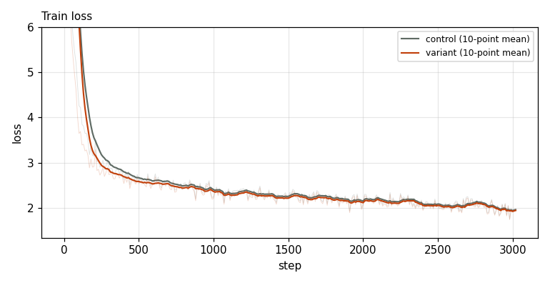
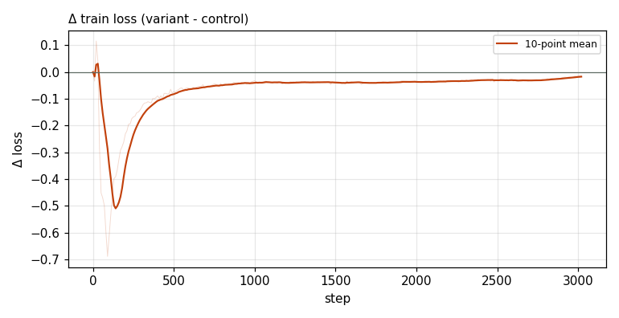

# X0250 · MuonC anneal 0.2 + AdamC head/router/embed · speedrun · win

Trial t001 · commit `b34f7c6e82` · [#9514 comment](https://github.com/marin-community/marin/issues/9514#issuecomment-7023898181) · approved by @armorfaye (trusted)

## Final eval

| Run | Paloma macro loss | Δ vs control | Paloma macro BPB |
|---|---|---|---|
| belay-X0250-control | 3.0472 |  | 1.2602 |
| belay-X0250-seed0 | 3.0269 | -0.0203 | 1.2519 |

Rule: Δ ≤ −0.005 win · ≥ +0.005 loss · otherwise noise. Verdict on loss; BPB (byte-weighted) shown for reference. The final speedrun verdict is the equal-time verdict.

## Train loss

## Δ train loss

## Speed (median after step 5)

| Run | s/step | tokens/s |
|---|---|---|
| belay-X0250-control | 0.1587 | 3302985 |
| belay-X0250-seed0 | 0.1577 | 3325084 |

## MoE routing: capacity drops (mean over layers)

| Control | Variant |
|---|---|
| 0.000811 | 0.001237 |

## MoE routing: router bias max

| Control | Variant |
|---|---|
| 1.927476 | 1.296601 |

## Gradient norm

| Control | Variant |
|---|---|
| 0.310817 | 0.186817 |
