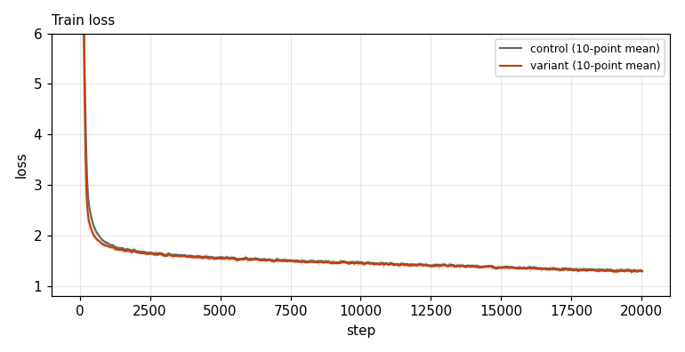
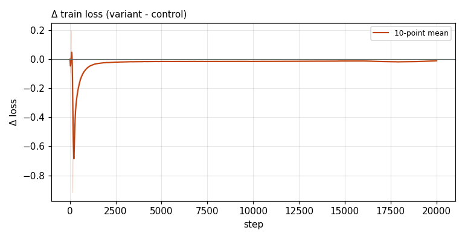

# X0250 · MuonC anneal 0.2 + AdamC head/router/embed · competitive-d1280 · win

Trial t005 · commit `b937bacc88` · [#9514 comment](https://github.com/marin-community/marin/issues/9514#issuecomment-7039740276) · approved by @armorfaye (trusted)

## Final eval

| Run | Paloma macro loss | Δ vs control | Paloma macro BPB |
|---|---|---|---|
| s7n-d1280L16 | 2.2706 |  | 0.9459 |
| belay-X0250d1280-seed0 | 2.2600 | -0.0107 | 0.9417 |

Rule: Δ ≤ −0.005 win · ≥ +0.005 loss · otherwise noise. Verdict on loss; BPB (byte-weighted) shown for reference.

## Train loss

## Δ train loss

## Speed (median after step 5)

| Run | s/step | tokens/s |
|---|---|---|
| s7n-d1280L16 | 2.8259 | 1484215 |
| belay-X0250d1280-seed0 | 2.8136 | 1490736 |

## MoE routing: capacity drops (mean over layers)

| Control | Variant |
|---|---|
| 0.000212 | 0.000342 |

## MoE routing: router bias max

| Control | Variant |
|---|---|
| 1.905005 | 1.218109 |

## Gradient norm

| Control | Variant |
|---|---|
| 0.271355 | 0.247429 |
