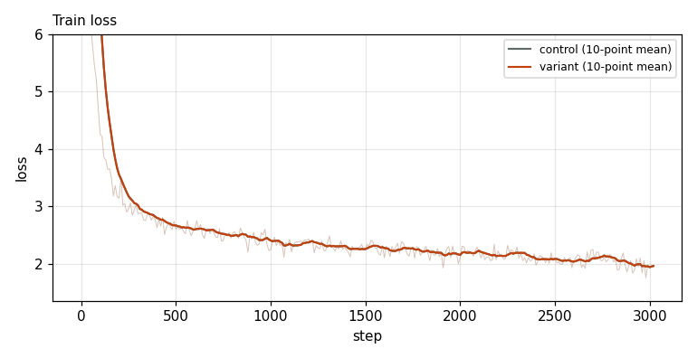
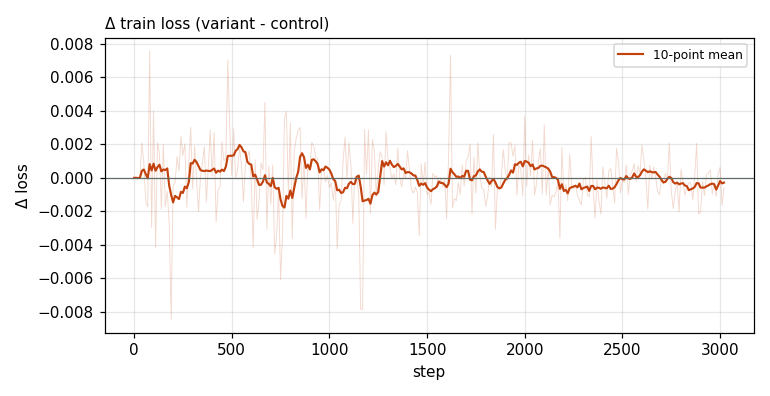

# X0251 · Hyperball linear init removal · speedrun · noise

Trial t001 · commit `932d5e08a1` · [#9514 comment](https://github.com/marin-community/marin/issues/9514#issuecomment-7004737316) · approved by @ClassicLarry

## Final eval

| Run | Paloma macro loss | Δ vs control | Paloma macro BPB |
|---|---|---|---|
| belay-X0251-control | 3.0450 |  | 1.2593 |
| belay-X0251-seed0 | 3.0430 | -0.0020 | 1.2585 |

Rule: Δ ≤ −0.005 win · ≥ +0.005 loss · otherwise noise. Verdict on loss; BPB (byte-weighted) shown for reference. The final speedrun verdict is the equal-time verdict.

## Train loss

## Δ train loss

## Speed (median after step 5)

| Run | s/step | tokens/s |
|---|---|---|
| belay-X0251-control | 0.1588 | 3302025 |
| belay-X0251-seed0 | 0.1597 | 3283480 |

## MoE routing: capacity drops (mean over layers)

| Control | Variant |
|---|---|
| 0.000838 | 0.000861 |

## MoE routing: router bias max

| Control | Variant |
|---|---|
| 3.183447 | 1.977493 |

## Gradient norm

| Control | Variant |
|---|---|
| 0.310362 | 0.312764 |
