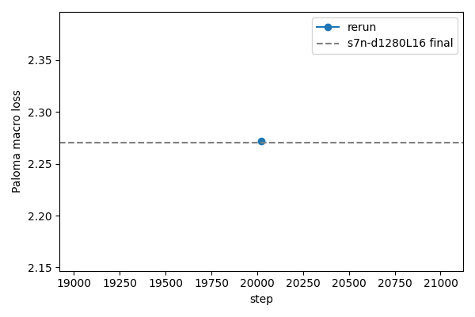

# X0254: same-commit recipe rerun at d1280

Baseline: `s7n-d1280L16`, final Paloma macro loss 2.2706 (another commit).

| | Value |
|---|---|
| Rerun final Paloma macro (step 20022) | 2.2716 |
| Rerun - baseline | +0.0010 |
| Implied shift of every ladder projection (-0.98 * offset) | -0.0010 |

Result: +0.0010: between the match and bias thresholds; inconclusive.

Measured against this rerun instead of the baseline, each ladder's d1280 difference moves by -0.0010 and its projected difference by -0.0010.

