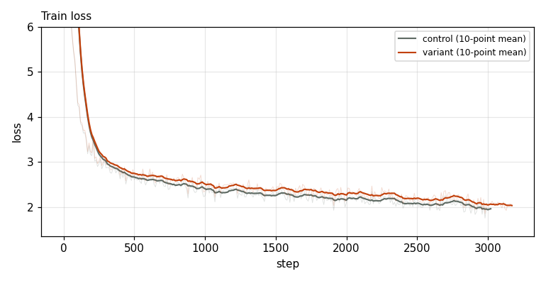
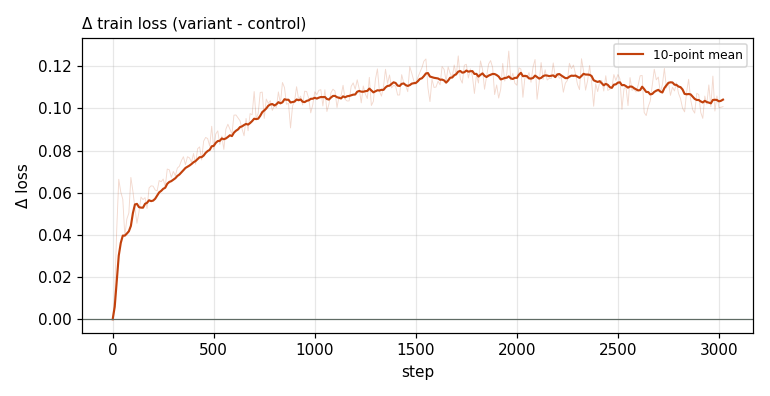

# X0255 · Debiased sampled softmax head · speedrun · loss

Trial t002 · commit `cb3d3539f3` · [#9514 comment](https://github.com/marin-community/marin/issues/9514#issuecomment-7083603637) · approved by @WhenWen (trusted)

## Final eval

| Run | Paloma macro loss | Δ vs control | Paloma macro BPB |
|---|---|---|---|
| belay-X0255-control | 3.0442 |  | 1.2590 |
| belay-X0255-seed0-t | 3.1178 | +0.0736 | 1.2888 |

Rule: Δ ≤ −0.005 win · ≥ +0.005 loss · otherwise noise. Verdict on loss; BPB (byte-weighted) shown for reference. The final speedrun verdict is the equal-time verdict.

## Train loss

## Δ train loss

## Speed (median after step 5)

| Run | s/step | tokens/s |
|---|---|---|
| belay-X0255-control | 0.1590 | 3298242 |
| belay-X0255-seed0-t | 0.1532 | 3421697 |

## MoE routing: capacity drops (mean over layers)

| Control | Variant |
|---|---|
| 0.000827 | 0.000866 |

## MoE routing: router bias max

| Control | Variant |
|---|---|
| 1.949343 | 2.162955 |

## Gradient norm

| Control | Variant |
|---|---|
| 0.309289 | 0.301263 |
