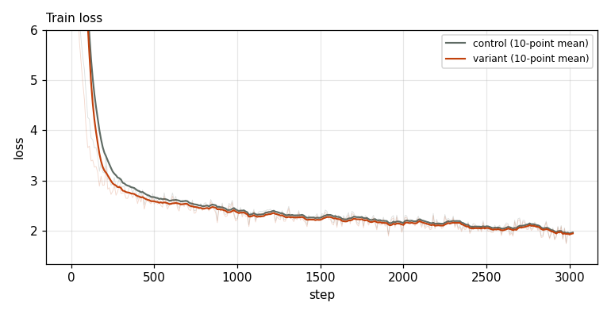
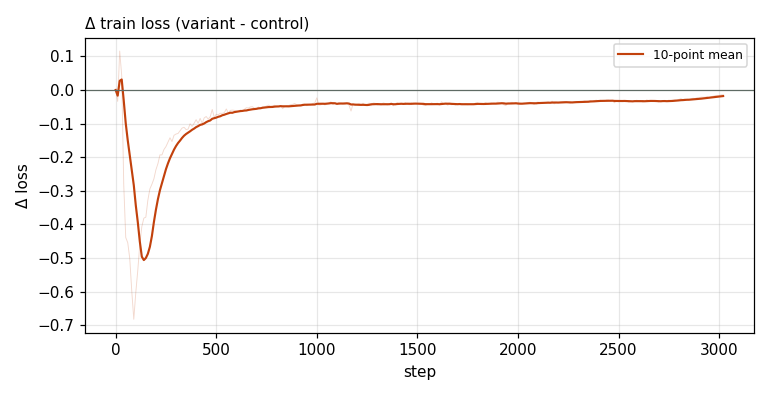

# X0256 · X0250 with matrix LR clamped at schedule floor · speedrun · win

Trial t001 · commit `ec7f97fde2` · [#9514 comment](https://github.com/marin-community/marin/issues/9514#issuecomment-7122322467) · approved by @armorfaye (trusted)

## Final eval

| Run | Paloma macro loss | Δ vs control | Paloma macro BPB |
|---|---|---|---|
| belay-X0256-control | 3.0452 |  | 1.2595 |
| belay-X0256-seed0 | 3.0270 | -0.0182 | 1.2519 |

Rule: Δ ≤ −0.005 win · ≥ +0.005 loss · otherwise noise. Verdict on loss; BPB (byte-weighted) shown for reference. The final speedrun verdict is the equal-time verdict.

## Train loss

## Δ train loss

## Speed (median after step 5)

| Run | s/step | tokens/s |
|---|---|---|
| belay-X0256-control | 0.1592 | 3293795 |
| belay-X0256-seed0 | 0.1578 | 3321988 |

## MoE routing: capacity drops (mean over layers)

| Control | Variant |
|---|---|
| 0.000917 | 0.001245 |

## MoE routing: router bias max

| Control | Variant |
|---|---|
| 1.815390 | 1.645312 |

## Gradient norm

| Control | Variant |
|---|---|
| 0.314427 | 0.192903 |
