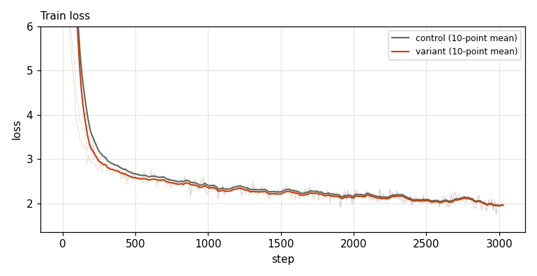
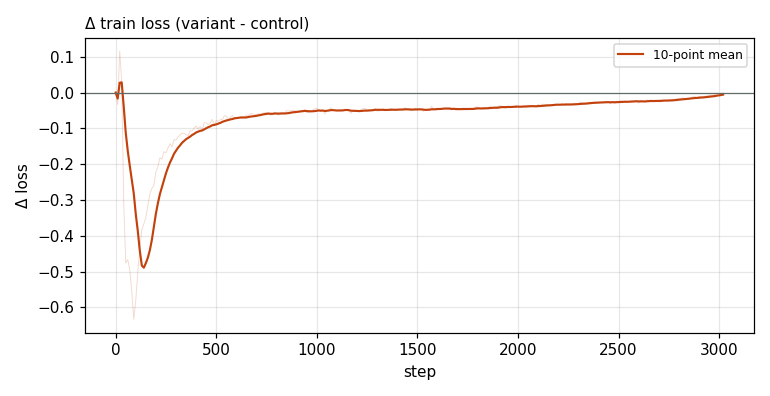

# X0258 · Law-cap ball with X0250 AdamC head and Adam decays · speedrun · win

Trial t002 · commit `77c984416e` · [#9514 comment](https://github.com/marin-community/marin/issues/9514#issuecomment-7148189436) · approved by @WhenWen (trusted)

## Final eval

| Run | Paloma macro loss | Δ vs control | Paloma macro BPB |
|---|---|---|---|
| belay-X0258-control | 3.0466 |  | 1.2600 |
| belay-X0258-seed0-t | 3.0375 | -0.0091 | 1.2563 |

Rule: Δ ≤ −0.005 win · ≥ +0.005 loss · otherwise noise. Verdict on loss; BPB (byte-weighted) shown for reference. The final speedrun verdict is the equal-time verdict.

## Train loss

## Δ train loss

## Speed (median after step 5)

| Run | s/step | tokens/s |
|---|---|---|
| belay-X0258-control | 0.1605 | 3267159 |
| belay-X0258-seed0-t | 0.1590 | 3297438 |

## MoE routing: capacity drops (mean over layers)

| Control | Variant |
|---|---|
| 0.000826 | 0.001268 |

## MoE routing: router bias max

| Control | Variant |
|---|---|
| 1.750479 | 1.348742 |

## Gradient norm

| Control | Variant |
|---|---|
| 0.310454 | 0.159990 |
