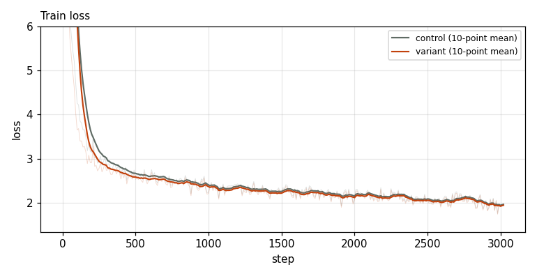
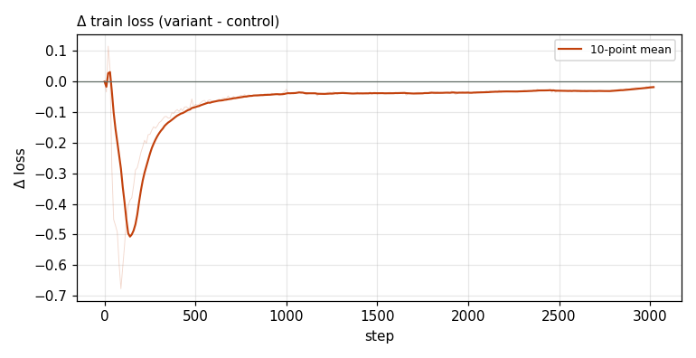

# X0259 · X0250 with first-order matrix decay floor f=0.05 · speedrun · win

Trial t001 · commit `47733d3a1b` · [#9514 comment](https://github.com/marin-community/marin/issues/9514#issuecomment-7204859845) · approved by @armorfaye (trusted)

## Final eval

| Run | Paloma macro loss | Δ vs control | Paloma macro BPB |
|---|---|---|---|
| belay-X0259-control | 3.0448 |  | 1.2592 |
| belay-X0259-seed0 | 3.0257 | -0.0191 | 1.2516 |

Rule: Δ ≤ −0.005 win · ≥ +0.005 loss · otherwise noise. Verdict on loss; BPB (byte-weighted) shown for reference. The final speedrun verdict is the equal-time verdict.

## Train loss

## Δ train loss

## Speed (median after step 5)

| Run | s/step | tokens/s |
|---|---|---|
| belay-X0259-control | 0.1592 | 3292539 |
| belay-X0259-seed0 | 0.1594 | 3289041 |

## MoE routing: capacity drops (mean over layers)

| Control | Variant |
|---|---|
| 0.000769 | 0.001252 |

## MoE routing: router bias max

| Control | Variant |
|---|---|
| 1.954801 | 1.265419 |

## Gradient norm

| Control | Variant |
|---|---|
| 0.311716 | 0.192727 |
