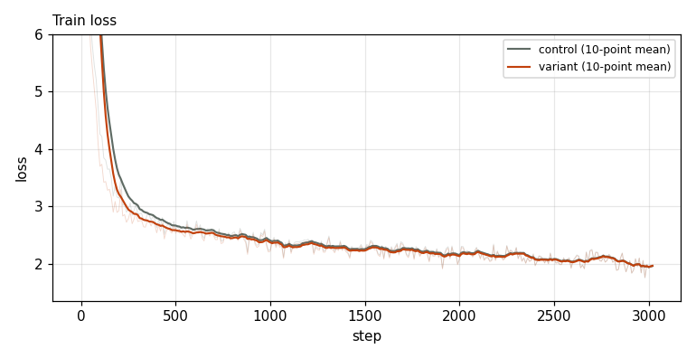
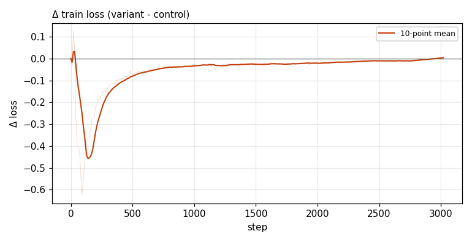

# X0261 · X0250 + per-token normalized momentum head · speedrun · win

Trial t001 · commit `60e92bb6f5` · [#9514 comment](https://github.com/marin-community/marin/issues/9514#issuecomment-7206918115) · approved by @armorfaye (trusted)

## Final eval

| Run | Paloma macro loss | Δ vs control | Paloma macro BPB |
|---|---|---|---|
| belay-X0261-control | 3.0450 |  | 1.2593 |
| belay-X0261-seed0 | 3.0283 | -0.0167 | 1.2526 |

Rule: Δ ≤ −0.005 win · ≥ +0.005 loss · otherwise noise. Verdict on loss; BPB (byte-weighted) shown for reference. The final speedrun verdict is the equal-time verdict.

## Train loss

## Δ train loss

## Speed (median after step 5)

| Run | s/step | tokens/s |
|---|---|---|
| belay-X0261-control | 0.1588 | 3301752 |
| belay-X0261-seed0 | 0.1582 | 3314219 |

## MoE routing: capacity drops (mean over layers)

| Control | Variant |
|---|---|
| 0.000834 | 0.001270 |

## MoE routing: router bias max

| Control | Variant |
|---|---|
| 1.861639 | 1.373463 |

## Gradient norm

| Control | Variant |
|---|---|
| 0.309510 | 0.185291 |
