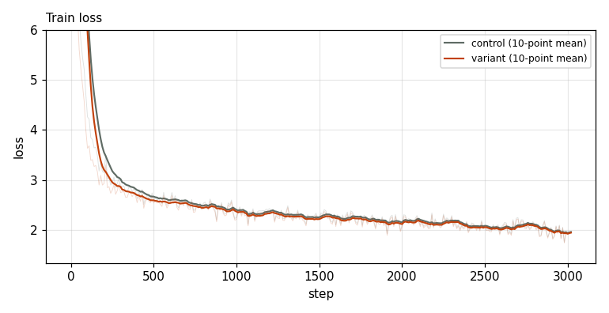
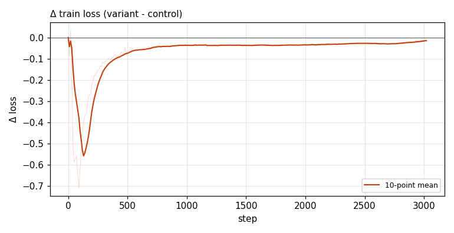

# X0262 · X0250 matrices at sqrt(2) norm, same rotation · speedrun · win

Trial t001 · commit `c43f574bd9` · [#9514 comment](https://github.com/marin-community/marin/issues/9514#issuecomment-7208904313) · approved by @armorfaye (trusted)

## Final eval

| Run | Paloma macro loss | Δ vs control | Paloma macro BPB |
|---|---|---|---|
| belay-X0262-control | 3.0473 |  | 1.2603 |
| belay-X0262-seed0 | 3.0270 | -0.0203 | 1.2521 |

Rule: Δ ≤ −0.005 win · ≥ +0.005 loss · otherwise noise. Verdict on loss; BPB (byte-weighted) shown for reference. The final speedrun verdict is the equal-time verdict.

## Train loss

## Δ train loss

## Speed (median after step 5)

| Run | s/step | tokens/s |
|---|---|---|
| belay-X0262-control | 0.1593 | 3291442 |
| belay-X0262-seed0 | 0.1583 | 3312811 |

## MoE routing: capacity drops (mean over layers)

| Control | Variant |
|---|---|
| 0.000859 | 0.001367 |

## MoE routing: router bias max

| Control | Variant |
|---|---|
| 1.824445 | 1.231758 |

## Gradient norm

| Control | Variant |
|---|---|
| 0.313207 | 0.196328 |
