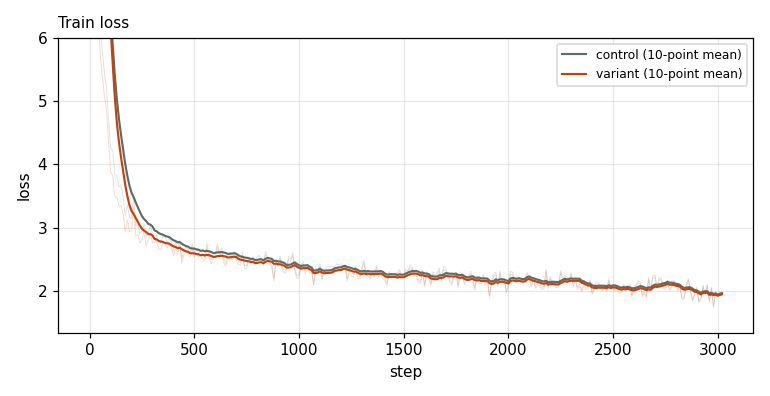
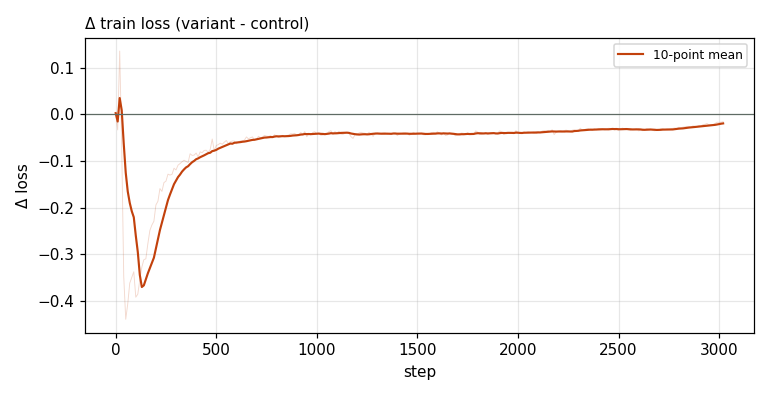

# X0263 · X0250 matrices start at 2x init norm · speedrun · win

Trial t001 · commit `c2ef08f0a6` · [#9514 comment](https://github.com/marin-community/marin/issues/9514#issuecomment-7208904984) · approved by @armorfaye (trusted)

## Final eval

| Run | Paloma macro loss | Δ vs control | Paloma macro BPB |
|---|---|---|---|
| belay-X0263-control | 3.0438 |  | 1.2590 |
| belay-X0263-seed0 | 3.0303 | -0.0135 | 1.2532 |

Rule: Δ ≤ −0.005 win · ≥ +0.005 loss · otherwise noise. Verdict on loss; BPB (byte-weighted) shown for reference. The final speedrun verdict is the equal-time verdict.

## Train loss

## Δ train loss

## Speed (median after step 5)

| Run | s/step | tokens/s |
|---|---|---|
| belay-X0263-control | 0.1594 | 3288816 |
| belay-X0263-seed0 | 0.1580 | 3318450 |

## MoE routing: capacity drops (mean over layers)

| Control | Variant |
|---|---|
| 0.000828 | 0.001365 |

## MoE routing: router bias max

| Control | Variant |
|---|---|
| 2.501913 | 1.344072 |

## Gradient norm

| Control | Variant |
|---|---|
| 0.308468 | 0.180876 |
