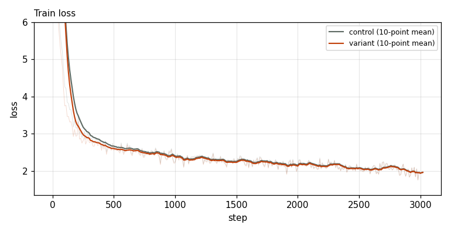
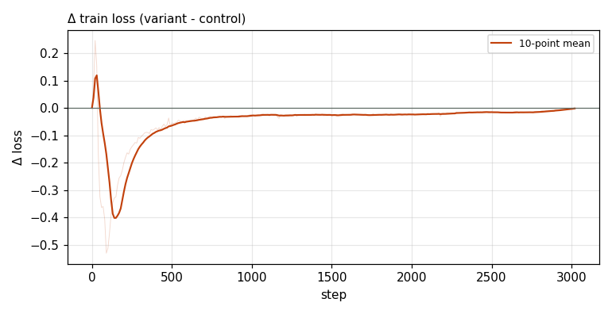

# X0264 · X0250 + token_embed per-row hyperball step · speedrun · noise

Trial t001 · commit `3021c1eef9` · [#9514 comment](https://github.com/marin-community/marin/issues/9514#issuecomment-7208905691) · approved by @armorfaye (trusted)

## Final eval

| Run | Paloma macro loss | Δ vs control | Paloma macro BPB |
|---|---|---|---|
| belay-X0264-control | 3.0463 |  | 1.2600 |
| belay-X0264-seed0 | 3.0436 | -0.0027 | 1.2585 |

Rule: Δ ≤ −0.005 win · ≥ +0.005 loss · otherwise noise. Verdict on loss; BPB (byte-weighted) shown for reference. The final speedrun verdict is the equal-time verdict.

## Train loss

## Δ train loss

## Speed (median after step 5)

| Run | s/step | tokens/s |
|---|---|---|
| belay-X0264-control | 0.1587 | 3302621 |
| belay-X0264-seed0 | 0.1578 | 3322099 |

## MoE routing: capacity drops (mean over layers)

| Control | Variant |
|---|---|
| 0.000797 | 0.000969 |

## MoE routing: router bias max

| Control | Variant |
|---|---|
| 1.723308 | 1.439587 |

## Gradient norm

| Control | Variant |
|---|---|
| 0.303182 | 0.200734 |
