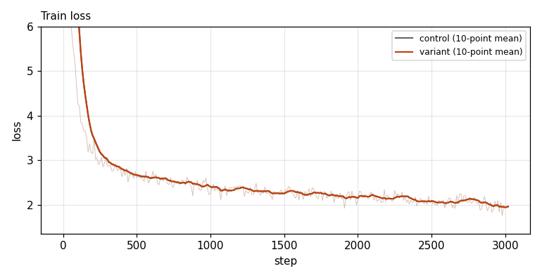
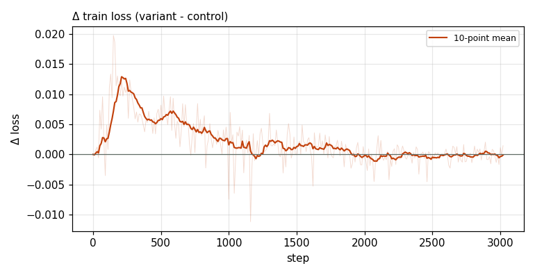

# X0265 · ID Balancing router bias · speedrun · noise

Trial t002 · commit `55305d20e9` · [#9514 comment](https://github.com/marin-community/marin/issues/9514#issuecomment-7209715736) · approved by @WhenWen (trusted)

## Final eval

| Run | Paloma macro loss | Δ vs control | Paloma macro BPB |
|---|---|---|---|
| belay-X0265v1-control | 3.0457 |  | 1.2598 |
| belay-X0265v2-seed0 | 3.0443 | -0.0014 | 1.2591 |

Rule: Δ ≤ −0.005 win · ≥ +0.005 loss · otherwise noise. Verdict on loss; BPB (byte-weighted) shown for reference. The final speedrun verdict is the equal-time verdict.

## Train loss

## Δ train loss

## Speed (median after step 5)

| Run | s/step | tokens/s |
|---|---|---|
| belay-X0265v1-control | 0.1603 | 3269773 |
| belay-X0265v2-seed0 | 0.1574 | 3329944 |

## MoE routing: capacity drops (mean over layers)

| Control | Variant |
|---|---|
| 0.000897 | 0.002003 |

## MoE routing: router bias max

| Control | Variant |
|---|---|
| 1.879711 | 2.965180 |

## Gradient norm

| Control | Variant |
|---|---|
| 0.305127 | 0.310061 |
