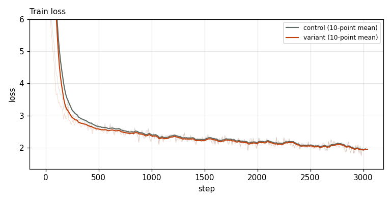
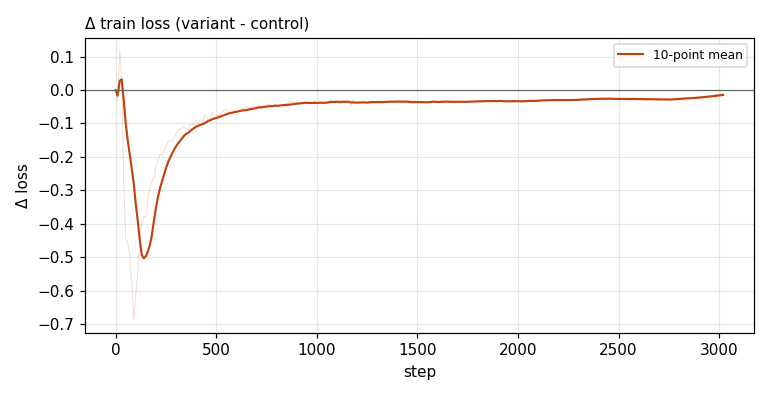

# X0266 · X0250 + matrix LR floor + decay floor f=0.05 · speedrun · win

Trial t002 · commit `383ff48039` · [#9514 comment](https://github.com/marin-community/marin/issues/9514#issuecomment-7212009445) · approved by @armorfaye (trusted)

## Final eval

| Run | Paloma macro loss | Δ vs control | Paloma macro BPB |
|---|---|---|---|
| belay-X0266-control | 3.0444 |  | 1.2589 |
| belay-X0266-seed0-t | 3.0280 | -0.0164 | 1.2525 |

Rule: Δ ≤ −0.005 win · ≥ +0.005 loss · otherwise noise. Verdict on loss; BPB (byte-weighted) shown for reference. The final speedrun verdict is the equal-time verdict.

## Train loss

## Δ train loss

## Speed (median after step 5)

| Run | s/step | tokens/s |
|---|---|---|
| belay-X0266-control | 0.1595 | 3287385 |
| belay-X0266-seed0-t | 0.1585 | 3308358 |

## MoE routing: capacity drops (mean over layers)

| Control | Variant |
|---|---|
| 0.000898 | 0.001261 |

## MoE routing: router bias max

| Control | Variant |
|---|---|
| 1.809408 | 1.411758 |

## Gradient norm

| Control | Variant |
|---|---|
| 0.310723 | 0.193460 |
