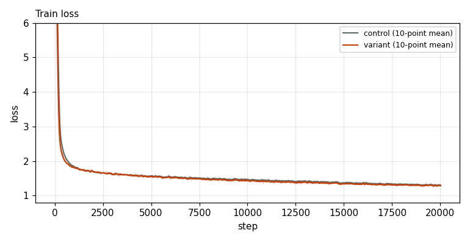
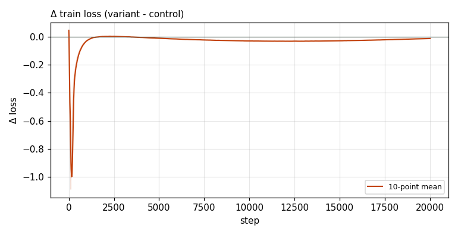

# X0268 · AIR-scheduled softcap MuonH, head law, 4x embed LR · competitive-d1280 · win

Trial t004 · commit `227dddee7b` · [#9514 comment](https://github.com/marin-community/marin/issues/9514#issuecomment-7224764268) · approved by @WhenWen (trusted)

## Final eval

| Run | Paloma macro loss | Δ vs control | Paloma macro BPB |
|---|---|---|---|
| s7n-d1280L16 | 2.2706 |  | 0.9459 |
| belay-X0268d1280-seed0 | 2.2580 | -0.0127 | 0.9409 |

Rule: Δ ≤ −0.005 win · ≥ +0.005 loss · otherwise noise. Verdict on loss; BPB (byte-weighted) shown for reference.

## Train loss

## Δ train loss

## Speed (median after step 5)

| Run | s/step | tokens/s |
|---|---|---|
| s7n-d1280L16 | 2.8259 | 1484215 |
| belay-X0268d1280-seed0 | 2.8242 | 1485120 |

## MoE routing: capacity drops (mean over layers)

| Control | Variant |
|---|---|
| 0.000212 | 0.000353 |

## MoE routing: router bias max

| Control | Variant |
|---|---|
| 1.905005 | 2.107297 |

## Gradient norm

| Control | Variant |
|---|---|
| 0.271355 | 0.254992 |
