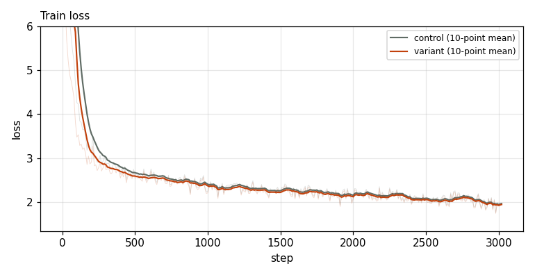
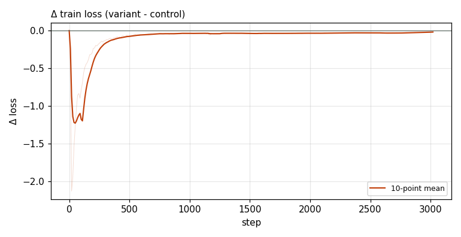

# X0269 · X0250 with plain AdamW head · speedrun · win

Trial t001 · commit `7ad1499722` · [#9514 comment](https://github.com/marin-community/marin/issues/9514#issuecomment-7228102754) · approved by @armorfaye (trusted)

## Final eval

| Run | Paloma macro loss | Δ vs control | Paloma macro BPB |
|---|---|---|---|
| belay-X0269-control | 3.0456 |  | 1.2596 |
| belay-X0269-seed0 | 3.0320 | -0.0137 | 1.2540 |

Rule: Δ ≤ −0.005 win · ≥ +0.005 loss · otherwise noise. Verdict on loss; BPB (byte-weighted) shown for reference. The final speedrun verdict is the equal-time verdict.

## Train loss

## Δ train loss

## Speed (median after step 5)

| Run | s/step | tokens/s |
|---|---|---|
| belay-X0269-control | 0.1595 | 3287870 |
| belay-X0269-seed0 | 0.1591 | 3295939 |

## MoE routing: capacity drops (mean over layers)

| Control | Variant |
|---|---|
| 0.000815 | 0.001673 |

## MoE routing: router bias max

| Control | Variant |
|---|---|
| 1.873031 | 1.692961 |

## Gradient norm

| Control | Variant |
|---|---|
| 0.307790 | 0.151292 |
