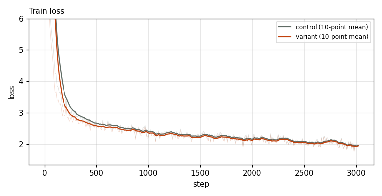
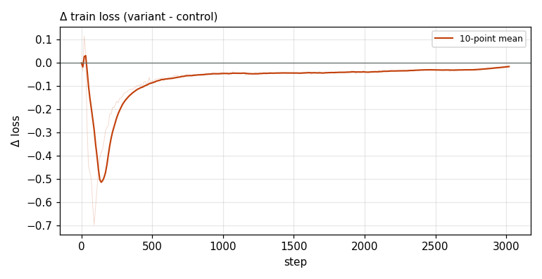

# X0270 · X0250 with no token_embed decay · speedrun · win

Trial t001 · commit `302f42c200` · [#9514 comment](https://github.com/marin-community/marin/issues/9514#issuecomment-7228103459) · approved by @armorfaye (trusted)

## Final eval

| Run | Paloma macro loss | Δ vs control | Paloma macro BPB |
|---|---|---|---|
| belay-X0270-control | 3.0437 |  | 1.2588 |
| belay-X0270-seed0 | 3.0300 | -0.0137 | 1.2534 |

Rule: Δ ≤ −0.005 win · ≥ +0.005 loss · otherwise noise. Verdict on loss; BPB (byte-weighted) shown for reference. The final speedrun verdict is the equal-time verdict.

## Train loss

## Δ train loss

## Speed (median after step 5)

| Run | s/step | tokens/s |
|---|---|---|
| belay-X0270-control | 0.1590 | 3298224 |
| belay-X0270-seed0 | 0.1576 | 3327554 |

## MoE routing: capacity drops (mean over layers)

| Control | Variant |
|---|---|
| 0.000875 | 0.001169 |

## MoE routing: router bias max

| Control | Variant |
|---|---|
| 1.887663 | 1.310382 |

## Gradient norm

| Control | Variant |
|---|---|
| 0.306991 | 0.189448 |
