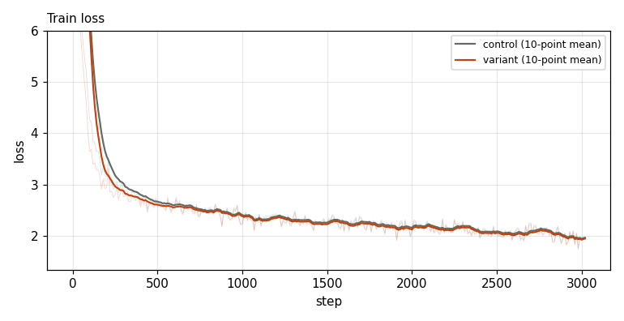
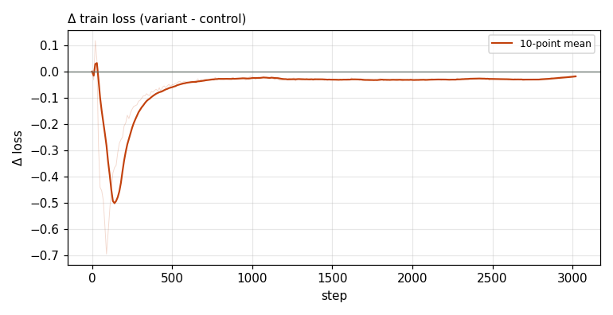

# X0271 · X0250 with row-AdamH token_embed · speedrun · win

Trial t001 · commit `a94c3bcf8f` · [#9514 comment](https://github.com/marin-community/marin/issues/9514#issuecomment-7228104107) · approved by @armorfaye (trusted)

## Final eval

| Run | Paloma macro loss | Δ vs control | Paloma macro BPB |
|---|---|---|---|
| belay-X0271-control | 3.0445 |  | 1.2592 |
| belay-X0271-seed0 | 3.0241 | -0.0204 | 1.2509 |

Rule: Δ ≤ −0.005 win · ≥ +0.005 loss · otherwise noise. Verdict on loss; BPB (byte-weighted) shown for reference. The final speedrun verdict is the equal-time verdict.

## Train loss

## Δ train loss

## Speed (median after step 5)

| Run | s/step | tokens/s |
|---|---|---|
| belay-X0271-control | 0.1592 | 3293458 |
| belay-X0271-seed0 | 0.1588 | 3302368 |

## MoE routing: capacity drops (mean over layers)

| Control | Variant |
|---|---|
| 0.000814 | 0.001255 |

## MoE routing: router bias max

| Control | Variant |
|---|---|
| 1.840091 | 1.560905 |

## Gradient norm

| Control | Variant |
|---|---|
| 0.308102 | 0.195599 |
