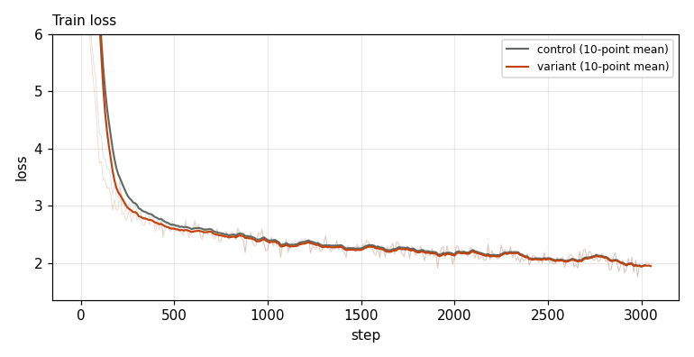
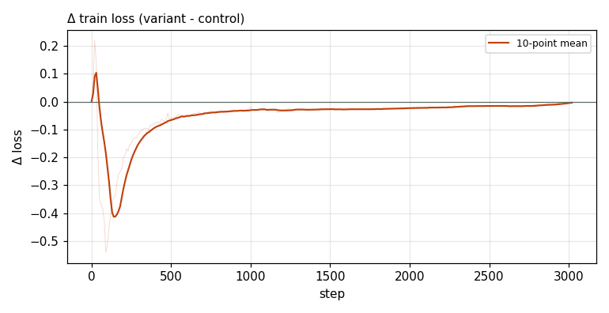

# X0272 · X0250 row-AdamH token_embed at LR / 3.65 · speedrun · win

Trial t002 · commit `98c6c00fed` · [#9514 comment](https://github.com/marin-community/marin/issues/9514#issuecomment-7228104770) · approved by @armorfaye (trusted)

## Final eval

| Run | Paloma macro loss | Δ vs control | Paloma macro BPB |
|---|---|---|---|
| belay-X0272-control | 3.0465 |  | 1.2598 |
| belay-X0272-seed0-t | 3.0407 | -0.0058 | 1.2575 |

Rule: Δ ≤ −0.005 win · ≥ +0.005 loss · otherwise noise. Verdict on loss; BPB (byte-weighted) shown for reference. The final speedrun verdict is the equal-time verdict.

## Train loss

## Δ train loss

## Speed (median after step 5)

| Run | s/step | tokens/s |
|---|---|---|
| belay-X0272-control | 0.1604 | 3267816 |
| belay-X0272-seed0-t | 0.1583 | 3312399 |

## MoE routing: capacity drops (mean over layers)

| Control | Variant |
|---|---|
| 0.000807 | 0.001041 |

## MoE routing: router bias max

| Control | Variant |
|---|---|
| 1.844535 | 1.404257 |

## Gradient norm

| Control | Variant |
|---|---|
| 0.306098 | 0.198977 |
