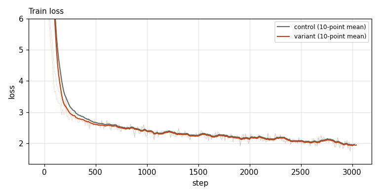
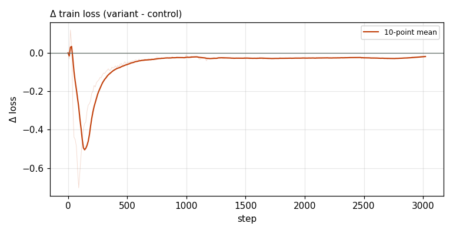

# X0273 · X0271 with X0259 matrix decay floor · speedrun · win

Trial t002 · commit `d7a2020fce` · [#9514 comment](https://github.com/marin-community/marin/issues/9514#issuecomment-7229403397) · approved by @armorfaye (trusted)

## Final eval

| Run | Paloma macro loss | Δ vs control | Paloma macro BPB |
|---|---|---|---|
| belay-X0273-control | 3.0443 |  | 1.2589 |
| belay-X0273-seed0-t | 3.0231 | -0.0212 | 1.2505 |

Rule: Δ ≤ −0.005 win · ≥ +0.005 loss · otherwise noise. Verdict on loss; BPB (byte-weighted) shown for reference. The final speedrun verdict is the equal-time verdict.

## Train loss

## Δ train loss

## Speed (median after step 5)

| Run | s/step | tokens/s |
|---|---|---|
| belay-X0273-control | 0.1606 | 3263911 |
| belay-X0273-seed0-t | 0.1588 | 3302013 |

## MoE routing: capacity drops (mean over layers)

| Control | Variant |
|---|---|
| 0.000892 | 0.001246 |

## MoE routing: router bias max

| Control | Variant |
|---|---|
| 1.806332 | 1.648964 |

## Gradient norm

| Control | Variant |
|---|---|
| 0.309832 | 0.198623 |
