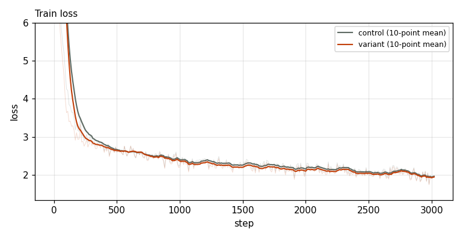
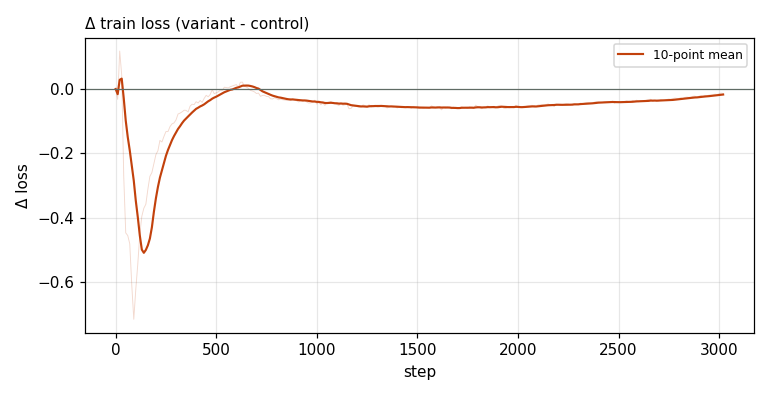

# X0274 · X0271 with front-heavy MuonC matrix LR · speedrun · win

Trial t001 · commit `ea82bd9d5b` · [#9514 comment](https://github.com/marin-community/marin/issues/9514#issuecomment-7229587642) · approved by @armorfaye (trusted)

## Final eval

| Run | Paloma macro loss | Δ vs control | Paloma macro BPB |
|---|---|---|---|
| belay-X0274-control | 3.0446 |  | 1.2592 |
| belay-X0274-seed0 | 3.0243 | -0.0203 | 1.2509 |

Rule: Δ ≤ −0.005 win · ≥ +0.005 loss · otherwise noise. Verdict on loss; BPB (byte-weighted) shown for reference. The final speedrun verdict is the equal-time verdict.

## Train loss

## Δ train loss

## Speed (median after step 5)

| Run | s/step | tokens/s |
|---|---|---|
| belay-X0274-control | 0.1586 | 3306317 |
| belay-X0274-seed0 | 0.1578 | 3323335 |

## MoE routing: capacity drops (mean over layers)

| Control | Variant |
|---|---|
| 0.000865 | 0.001294 |

## MoE routing: router bias max

| Control | Variant |
|---|---|
| 1.837276 | 1.533946 |

## Gradient norm

| Control | Variant |
|---|---|
| 0.311012 | 0.166736 |
