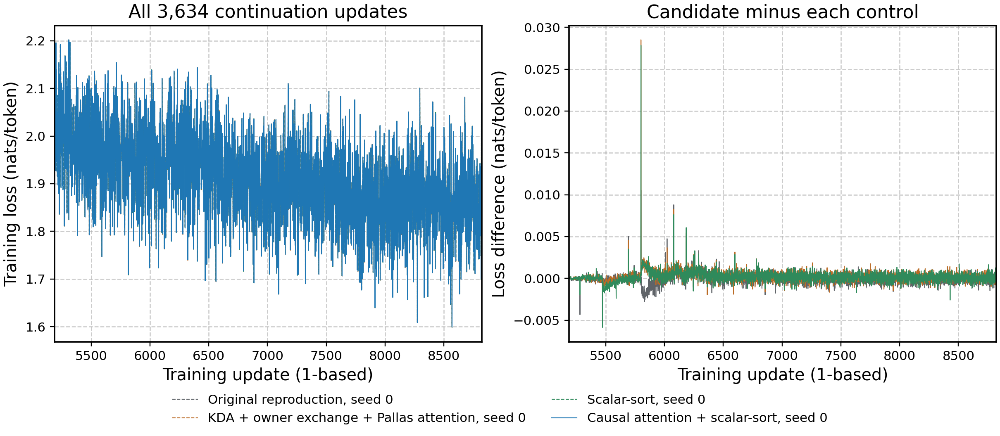

# Ckpt 1 TPU execution evidence

The selected `kda-owner-causal-sort-v1` profile measured 314.353 ms per
complete training update and 8.3620% useful MFU on v4-32. The 20% target is
still unmet. This result belongs to source commit
[`22db0f03a`](https://github.com/WhenWen/marin/commit/22db0f03a73c5bc101d23e514ae3feb111e4a8a0),
not to a new full-window run of this consolidated PR.

The run restored checkpoint 5,187 from the
[earlier Ckpt 1 reproduction](https://github.com/marin-community/marin/pull/10260#issuecomment-6404685780)
and completed zero-based updates 5,187–8,820
(3,634 updates), seed 0, batch 128 × sequence 4,096 on 16 physical TPU v4
chips with trainer pipeline depth 1. All four workers completed without OOM or non-finite loss. The
original 8,821-update schedule and 23-domain final evaluation were retained.

| Complete-update window | ms/update | Useful MFU |
|---|---:|---:|
| 5,387–5,686 | 314.253 | 8.3664% |
| 5,687–5,986 | 314.394 | 8.3583% |
| 5,987–6,286 | 314.413 | 8.3614% |
| Combined 900 updates | 314.353 | 8.3620% |

MFU divides the [frozen conservative useful-FLOP count](../useful_mfu.py) by synchronized window
time and 16 × 275 TFLOP/s peak BF16 throughput. The timer includes loading,
optimizer, communication and host callbacks. Padding and rematerialization
do not increase the numerator; omitted recurrence work makes this a lower
bound. The numerator varies with each batch's valid tokens, causal pairs and
dropped routes; the first window sums to 34,704,813,705,781,248 FLOPs over
300 updates. Window timing does not include final evaluation or startup.

The scalar-sort control used the same starting checkpoint, update range and
23-domain evaluation setup. It measured 326.273 ms/update and 8.0565%
MFU, so the selected windows have 3.653% lower update time. Total job duration was
1,380.69 seconds versus 1,369.72 seconds for scalar-sort; final evaluation
took 92.956 versus 52.537 seconds, with compile/cache effects not isolated.
The training-window improvement therefore does not establish faster total
job completion. Compiler temporary allocation in the short diagnostic was
20,138,671,616 bytes; runtime peak HBM for the complete run was not measured.

Across all 3,634 matched losses, mean absolute difference from scalar-sort
was 0.000440597 nats/token and maximum absolute difference was 0.0278499.
The last-300 mean signed difference (selected minus scalar-sort) was
+0.00008537 nats/token. Final weighted
validation loss was 2.557941675, versus 2.558131933 for scalar-sort and
2.558295012 for the original local-token reproduction. This is single-seed
trajectory evidence, not bitwise or multi-seed statistical equivalence.

The [loss CSVs by configuration](loss/), [comparison JSON](comparison.json), and
[raw window records](mfu-windows.json) accompany the plot. The
[finished W&B run](https://wandb.ai/marin-community/auto-understanding-arch/runs/ckpt1-causal-sort-full-v432-v2-67c908a6b721bcfd)
and [full result](https://github.com/WhenWen/astra-d8-research/issues/253#issuecomment-6427968884)
retain the execution and control identities.

## Experimental fused expert

The later fused-expert candidate reduced isolated production-shape expert
time by about 17%, but its 42-update diagnostic had a 330.090 ms warm median
versus 328.421 ms for the selected control. It missed the predeclared 1%
speed gate. Complete checkpoint replay passed; mean/max paired loss errors
were 0.0000620/0.0002251 and compiler temporary allocation fell to
18,324,701,184 bytes. It is excluded from the selected runtime.

In its one-host profile, expert matmul self-time fell by 5.002 ms/core/update,
while weight all-gather start/done self-time rose by 5.023 ms/core/update.
The fused forward needs both up and down weights before starting; the
separate up projection can start while down weights arrive. Lost overlap is
a hypothesis supported by this trace, not yet a controlled causal result.
HLO self-times are not removable wall-clock budgets. See the
[frozen protocol](https://github.com/WhenWen/astra-d8-research/issues/253#issuecomment-6429855678)
and [candidate W&B run](https://wandb.ai/marin-community/auto-understanding-arch/runs/ckpt1-fused-expert-update-v432-v1-4681e81bc00bcb1a).

## Consolidation checks

The PR keeps the old Belay+CPLM path and adds the Ckpt 1 variant separately.
The diagnostic now selects the same named profiles as the trainer. GPU-only
MoE extension arguments are rejected locally instead of replacing the older
shared MoE library. Checkpoint save decisions use host NumPy booleans before
the existing cross-host broadcast, avoiding unnecessary TPU placement.

Remote CPU numerical validation initially passed 308 cases before the
repository's 600-second session limit. Fourteen reference-oracle calls needed
the older PR's explicit `scan_impl="parallel"` argument; all 14 then passed,
along with three checkpoint-policy checks. The 21 remaining attention, MFU,
CPLM and scatter checks passed in a separate invocation. Six device-count
skips were covered by a 16-device collective invocation (14 passed); seven
pre-existing expected-failure cases remain recorded. No optimizer updates ran
on CPU, and no tolerance or timeout was relaxed.

Required formatting, lint, Pyrefly, source and file checks passed. The broad
affected-test plan was inspected but includes CPU training, so it was not
executed. The final CLI's
[online logging check](https://wandb.ai/marin-community/auto-understanding-arch/runs/ckpt1-pr10260-logging-v2-08ae8b90ce53)
finished with zero optimizer updates. A TPU checkpoint-continuation check and
the committed-branch advisory review are pending; these checks do not replace
the historical full-window measurement above.
