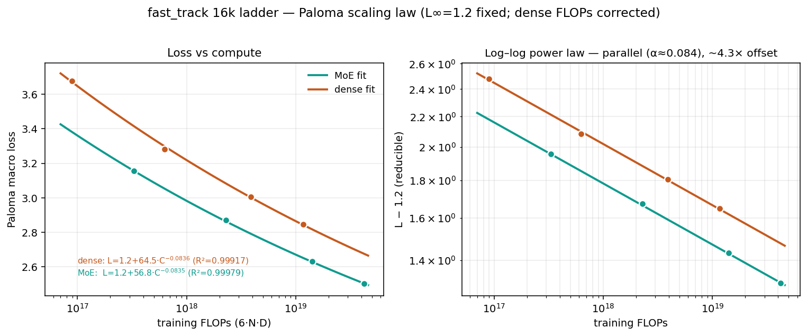

# fast_track — 16k-vocab H100 ladder for model and data changes

Self-contained grug variant with 16k vocab size for fast iteration. Dense and MoE baselines shown
below from 9.4e16 to 4.3e19 FLOPs.

## Tracks

Two tracks use the same dense and MoE ladder. Each track changes one input and keeps the others fixed.

| track | changes | data | command |
|-------|---------|------|---------|
| Model ladder | model, optimizer, or training recipe | frozen Hero cache | [`fast-track`](#launch-commands) |
| Quality classifier | document scorer that selects the training data | corpus-proportional raw pool from the registered DataKit sources | [`quality_cli`](#improve-a-quality-classifier) |

All training commands train the MoE model by default. Use `--dense` for the dense model.
When you do not give `--data-seed`, the data order comes from `--seed`.
`fast-track` must have `--size`. The data-track commands use `d512` by default.
The model ladder uses final Paloma macro loss (`eval/paloma/macro_loss`) as the primary metric.
The quality track uses the capability judge in [Compare data-track runs](#compare-data-track-runs), because one held-out loss does not rank data selections the way downstream tasks do.

## Run a data-track command

The data-track CLIs are `corpus_sample_cli`, `quality_labels_cli`, and `quality_cli`. Without `--run`, each CLI prints its plan.
To build the plan, run the CLI with `--run` in an Iris CPU coordinator on `cw-us-east-02a`:

```bash
uv run iris --cluster=marin job run --no-wait --target-cluster cw-us-east-02a \
  --cpu 2 --memory 8GB --enable-extra-resources --extra cpu --extra datakit \
  --job-name <name> -e WANDB_API_KEY "$WANDB_API_KEY" \
  -- python -m experiments.grug.fast_track.<cli> <options> --version <version> --run
```

The coordinator starts Zephyr workers and, for training, one 8xH100 child job.
The inputs are in `s3://marin-us-east-02a`.
The coordinator log gives the path of each completed artifact. Give that artifact directory to the next command.
The examples in this file show only the CLI and its options.

## Files

| file | contents |
|------|----------|
| [`launch.py`](launch.py) | ladder rungs, budget resolution (`--match`), Iris/W&B wiring |
| [`contracts.py`](contracts.py) | Shared data contracts and tokenization policy |
| [`batching.py`](batching.py) | Byte- and row-bounded tokenization batches |
| [`corpus_sample.py`](corpus_sample.py), [`corpus_sample_cli.py`](corpus_sample_cli.py) | Corpus-proportional raw pool from the registered sources |
| [`quality_labels.py`](quality_labels.py), [`quality_labels_cli.py`](quality_labels_cli.py), [`label_exclusion.py`](label_exclusion.py) | Frozen GLM labels, ridge head, and label exclusions |
| [`quality.py`](quality.py), [`quality_features.py`](quality_features.py) | Scorer interface, ridge head, label splits, and cached Harrier features |
| [`quality_pipeline.py`](quality_pipeline.py), [`ranked_pool.py`](ranked_pool.py) | Scored pool, ranked selection, and selected training cache |
| [`quality_cli.py`](quality_cli.py) | Quality-track command |
| [`downstream_tasks.py`](downstream_tasks.py), [`downstream_eval.py`](downstream_eval.py) | Frozen cloze, code, and math tasks, and the checkpoint scorer |
| [`quality_judge.py`](quality_judge.py) | Capability-group judge of a candidate against its random control |
| [`probe_scorers.py`](probe_scorers.py) | Probe selections that tested the judge |
| [`model.py`](model.py) | the transformer: attention, GatedNorm, SConv, QB-routed MoE |
| [`train.py`](train.py) | trainer/eval/loss wiring and runtime (XLA) defaults |
| [`optimizer.py`](optimizer.py) | MuonH optimizer config: LR groups + hyperball step |
| [`grugmuon_stacked.py`](grugmuon_stacked.py) | Newton-Schulz orthogonalization (Muon direction) |
| [`adamh.py`](adamh.py) | AdamH scale transform (the `adamh` LR group) |
| [`heuristic.py`](heuristic.py) | compute-scaling LR / beta2 / epsilon fit |
| [`router_metrics.py`](router_metrics.py) | routing-stats telemetry (logging-only) |

## Results

These recorded runs use the frozen Hero training cache.
`fast-track` reads it from `s3://marin-us-east-02a/marin/datakit/hero_tok/v16384_shuf/train`
(`V16384_CACHE_DIR` in `launch.py`). [`shuffle_cache.py`](shuffle_cache.py) shuffled its documents.
The [sample build record](https://github.com/marin-community/marin/issues/9188#issuecomment-5691769554)
describes the source sample. The scripts that built this sample are not in the repository.

| size | variant | TPP | batch | active | total | steps | tokens | FLOPs | MFU | Paloma loss | Paloma bpb | uncheat bpb | runtime |
|------|---------|----:|------:|-------:|------:|------:|-------:|------:|----:|------------:|-----------:|------------:|--------:|
| d512  | dense | 20 | 128 |  18.1M |  36.8M |    690 | 0.36B | 9.4e16 | 16.6% | 3.676 | 1.520 | 1.243 | 3.7m |
| d768  | dense | 20 | 128 |  53.5M |  82.3M |  2,040 | 1.07B | 6.3e17 | 20.2% | 3.283 | 1.361 | 1.063 | 9.2m |
| d1024 | dense | 20 | 256 | 144.7M | 185.3M |  2,760 | 2.89B | 3.9e18 | 26.7% | 3.006 | 1.248 | 0.945 | 34.8m |
| d1280 | dense | 20 | 256 | 261.5M | 313.6M |  4,988 | 5.23B | 1.2e19 | 28.8% | 2.847 | 1.183 | 0.881 | 1.5 hr |
| d512  | moe   | 60 | 128 |  20.8M |   483M |  2,385 | 1.25B | 3.5e17 |  8.2% | 3.156 | 1.308 | 1.008 | 14.0m |
| d768  | moe   | 60 | 128 |  60.6M |  1.42B |  6,930 | 3.63B | 2.3e18 | 10.3% | 2.872 | 1.193 | 0.888 | 54.4m |
| d1024 | moe   | 60 | 256 | 162.0M |  3.75B |  9,270 | 9.72B | 1.4e19 | 13.9% | 2.633 | 1.096 | 0.793 | 3.8 hr |
| d1280 | moe   | 60 | 256 | 291.3M |  6.81B | 16,669 | 17.5B | 4.3e19 | 15.6% | 2.504 | 1.044 | 0.741 | 10.0 hr |

W&B runs (project `marin-community/marin_moe`) —
dense: [d512](https://wandb.ai/marin-community/marin_moe/runs/fasttrack-dense-d512) ·
[d768](https://wandb.ai/marin-community/marin_moe/runs/fasttrack-dense-d768) ·
[d1024](https://wandb.ai/marin-community/marin_moe/runs/fasttrack-dense-d1024) ·
[d1280](https://wandb.ai/marin-community/marin_moe/runs/fasttrack-dense-d1280) —
moe: [d512](https://wandb.ai/marin-community/marin_moe/runs/fasttrack-moe-d512) ·
[d768](https://wandb.ai/marin-community/marin_moe/runs/fasttrack-moe-d768) ·
[d1024](https://wandb.ai/marin-community/marin_moe/runs/fasttrack-moe-d1024) ·
[d1280](https://wandb.ai/marin-community/marin_moe/runs/fasttrack-moe-d1280)

## Tokenizer impact (16k vs 128k)

Same MoE geometry and token budget, swapping the 16k BPE tokenizer for the 128k Marin (llama3-family)
tokenizer. bpb is byte-normalized so it compares fairly across tokenizers; per-token loss does not
(the 128k tokenizer packs more bytes per token, so higher loss at similar bpb).

| size | tokenizer | Paloma loss | Paloma bpb | uncheat bpb |
|------|-----------|------------:|-----------:|------------:|
| d512 | 16k  | 3.156 | 1.308 | 1.008 |
| d512 | 128k | 3.656 | 1.309 | 0.996 |
| d768 | 16k  | 2.872 | 1.193 | 0.888 |
| d768 | 128k | 3.306 | 1.187 | 0.870 |

Both runs train on the same number of tokens, but the 16k tokenizer compresses ~12% worse than the
128k, so at equal token budget the 16k run covers ~12% fewer bytes of text. Even with that data
disadvantage it lands ~neutral on Paloma bpb (+0.001 at d512, −0.006 at d768) and only slightly behind
on uncheatable bpb (−0.012 / −0.018).

## Scaling law

Fitting `L(C) = L∞ + A·C^(−α)` to Paloma macro loss over the four rungs (C = total training FLOPs), with
the irreducible floor pinned at **L∞ = 1.2**:

| variant | fit | R² | α |
|---------|-----|---:|--:|
| MoE   | `L = 1.2 + 58.67·C^(−0.0842)` | 0.99995 | 0.0842 |
| dense | `L = 1.2 + 66.70·C^(−0.0844)` | 0.99870 | 0.0844 |



**Compute efficiency:** the MoE recipe (60 TPP) reaches the same Paloma loss as the compute-optimal
dense recipe (20 TPP) with **~4.2× less compute**.

## Launch commands

Set `$WANDB_API_KEY` in your shell, or set `WANDB_MODE=disabled` for a run without W&B.

`fast-track` runs the model-ladder track. Without `--submit`, it prints the lowered plan.
With `--submit`, it starts an 8×H100 Iris job:

```bash
# inspect the plan locally — nothing is submitted
uv run fast-track --run-id dense-d768 --size d768 --dense --version 2026.09.17

# submit it as an Iris H100 job
uv run fast-track --submit --run-id dense-d768 --size d768 --dense --version 2026.09.17
```

`--submit` wraps the launcher in `iris job run … -- python -m …launch … --run` and forwards
`$WANDB_API_KEY` to the job. The default cluster is `cw-us-east-02a`.
Use `--target-cluster` to select another cluster.

Pick a size and variant; the budget defaults to **data-matching** that variant's baseline (dense at
20 TPP, MoE at 60 TPP) at the rung's baseline batch (128 for d512/d768, 256 for d1024/d1280). Steps
are derived automatically. Use `--match compute` to FLOP-match instead, `--batch-size` to change the
batch (steps rescale to hold the match), or `--num-steps` to set the count explicitly.

Dense (data-match baseline):

```bash
uv run fast-track --submit --run-id dense-d768 --size d768 --dense --version 2026.09.17
```

MoE (data-match baseline; bump the batch — steps halve to hold tokens):

```bash
uv run fast-track --submit --run-id moe-d768 --size d768 --batch-size 256 --version 2026.09.17
```

MFU probe (any size, quick — explicit short budget):

```bash
uv run fast-track --submit --run-id probe-d1280 --size d1280 --num-steps 20 --no-eval --version 2026.09.17
```

### Useful flags (all on `launch.py`)

| flag | effect |
|------|--------|
| `--run-id` | **required** run identifier for artifact + W&B names |
| `--size` | **required** `d512` / `d768` / `d1024` / `d1280` |
| `--version` | **required** artifact version: `YYYY.MM.DD` for coordinated runs, `dev` for scratch runs |
| `--dense` | dense 3×hidden SwiGLU, no MoE (expert axis 1) |
| `--match` | `data` (default) tokens-match or `compute` FLOP-match the variant baseline |
| `--batch-size` | override the rung's baseline batch (steps rescale to hold the match) |
| `--num-steps N` | set the step budget explicitly (ignores `--match`) |
| `--seed` / `--data-seed` | Model initialization and data-order seeds. Without `--data-seed`, the data order comes from `--seed`. |
| `--no-eval` | skip eval (clean MFU probes) |
| `--save-checkpoints` | save a permanent final checkpoint to S3 (off by default) |
| `--run` | Build the plan in the current process. `--submit` adds it to the job command. |
| `--submit` | Submit as an Iris H100 job. Omit to print the plan locally. |
| `--target-cluster` | Select the Iris cluster for submission. The default is `cw-us-east-02a`. |

Results land in W&B `marin-community/marin_moe`. The eval keys are `eval/paloma/macro_loss` and
`eval/uncheatable_eval/macro_loss`, with `macro_bpb` versions of the two (MoE dropless eval logs under
the normal `eval/` prefix).

## Prepare the reference pools

The quality-pool sampler uses Zephyr and writes a versioned artifact.
Runs at all ladder sizes can use the same artifact.

### Quality raw pool

The quality-pool sampler (`corpus_sample_cli`) reads all registered DataKit sources, at this time 292.
It reads their pinned normalized paths in `experiments/datakit/hero_data_paths.json`.
It rejects a source that has no pin.
The `corpus-id-interval-v1` policy selects a seeded cyclic interval in the normalized 128-bit document ID space.
Each source has its own fixed offset and the same interval width.
Normalized IDs are uniform content hashes, so the expected token share of a source agrees with its token mass.
Source estimates set the initial interval width.
When a pass gives too few tokens, the sampler doubles the width and reads again.
The output has a stable random order. The input partitions and the worker order do not change it.
The sampler reads a Parquet row group only when its ID statistics do not exclude the interval.
It tokenizes only the selected documents.

Build the pool after the label artifact, with `--label-exclusion-manifest`
(see [Improve a quality classifier](#improve-a-quality-classifier)).
Scoring rejects a pool that contains a labelled document.
`--max-training-tokens` sets the largest training budget. The default is 17,478,713,344 tokens.
The sampler requests ten times this budget: 174,787,133,440 raw tokens by default.
Whole-document boundaries can add a small number of tokens.
`--source <registry-name>` (repeatable) selects only the named sources.
Tokenizer content hashes are part of the artifact identity, so the plan must have access to the tokenizer.

At this time, a pool from all sources stops with an error.
The `stack-v3` source has documents of 79–213 MB, which is more than the 64 MiB limit of the
[tokenization policy](#tokenization-policy).
Until a policy for these documents exists, select the other sources with repeated `--source`.

### Tokenization policy

Corpus sampling uses the `fast-track-long-string-v1` tokenization policy
(`TOKENIZATION_POLICY` in `contracts.py`).
The policy divides text at the first whitespace at or after 10,000 characters.
A document larger than 64 MiB of UTF-8 text stops preparation.
The error gives the corpus source and document ID.
The policy name is part of the artifact identity.
`corpus.json` (`spec`) records it.
These limits decrease worker memory, but they do not set a fixed limit on worker memory.

## Improve a quality classifier

For a training budget `B`, this track reads the first `10*B` tokens of the fixed raw pool.
It scores this raw prefix and sorts the documents from the highest to the lowest score.
Then it selects documents until their total gets to `B` tokens.
Each rung gets its own selection. A smaller rung does not use a prefix of the selection of a larger rung.

Do these steps to compare a ridge head on GLM labels with a random selection.
Run each command as given in [Run a data-track command](#run-a-data-track-command).

1. Freeze the labels and fit the ridge head.
   This command builds a `FrozenQualityLabels` artifact and a `FittedRidgeQualityHead` artifact.

   ```bash
   uv run python -m experiments.grug.fast_track.quality_labels_cli \
     --regularization 0.001 --split-seed 0 --version 2026.10.04
   ```

2. Build the raw pool with the label exclusion from step 1.
   Repeat `--source` for each source other than `stack-v3` (see [Quality raw pool](#quality-raw-pool)).

   ```bash
   uv run python -m experiments.grug.fast_track.corpus_sample_cli \
     --label-exclusion-manifest <frozen-labels-artifact>/label_exclusion.json \
     --source <registry-name> --source <registry-name> \
     --seed 0 --version 2026.10.04
   ```

3. Score the raw pool one time at the largest rung.

   ```bash
   uv run python -m experiments.grug.fast_track.quality_cli \
     --raw-pool <raw-corpus-artifact> --ridge-head-artifact <fitted-head-artifact> \
     --stage score --size d1280 --version 2026.10.04
   ```

4. For each rung, train a candidate selection and a random selection from the `ScoredPool` of step 3.
   Give each run its own run ID.

   ```bash
   uv run python -m experiments.grug.fast_track.quality_cli \
     --scored-pool <scored-pool-artifact> --size d512 --dense \
     --run-id quality-candidate-d512 --selection-method candidate --save-checkpoints \
     --seed 0 --data-seed 0 --version 2026.10.04

   uv run python -m experiments.grug.fast_track.quality_cli \
     --scored-pool <scored-pool-artifact> --size d512 --dense \
     --run-id quality-random-d512 --selection-method random --save-checkpoints \
     --seed 0 --data-seed 0 --version 2026.10.04
   ```

5. Score each checkpoint and apply the [judge](#compare-data-track-runs).

The rungs use the same tokenization, embeddings, and classifier scores. Each rung builds its own selected token cache.
The scored pool must supply at least ten times the requested training tokens.
Do not use `--scored-pool` together with `--raw-pool` or the scorer, head, feature, or label-exclusion options.

### Stages and selection

`--stage` sets the last artifact of the plan: `features`, `score`, `select`, or `train` (default).
`--stage select` scores and prepares the selected cache, but does not train a model.
In the preparation stages, `--training-tokens` can set a small budget. The training stage rejects this option.
`--tie-seed` (default 0) sets the order of a random selection and the order of documents with equal scores.

Selection keeps whole documents, so the selected tokens can be more than `B`. The loader reads exactly `B` tokens.
The selected documents stay in the fixed random order of the raw pool. Classifier scores do not change this order.
The training source makes sure that the tokenizer content and the rung budget agree with the selection.
A candidate or incumbent selection stops with an error when all its scores on the rung prefix are equal.
A random selection does not use the scores.
A large candidate pool alone does not show that the classifier finds useful data.
Before a larger run, compare the evaluation results and examine the score and source distributions.

### Ridge head and labels

`quality_labels_cli` reads the default label sources from [PR #8303](https://github.com/marin-community/marin/pull/8303)
and its [joined-label producer](https://github.com/marin-community/marin/blob/a8bf53bdc953b16cf69b937af47eb7896e5d6e0b/experiments/datakit/scripts/join_glm52_labels_harrier50m.py):

- Original labels: `s3://marin-us-east-02a/marin/user/rav/quality_v2/glm52_labels_88k.parquet`
- Joined full text and embeddings: `s3://marin-us-east-02a/marin/user/muchanem/quality_v2/glm52_labels_88k-x-harrier-oss-v1-0.6b-50m-text-v1`.

`quality_labels_cli` validates the join and records the hashes of the input files before the head fit.
It rejects conflicting labels and text-ID mismatches.
For duplicate embeddings, it keeps the first row in sorted file-and-row order and records the vector differences.
GLM quality values are from 1 (lowest) to 5 (highest). The head fit uses the target `(quality - 1) / 4`.
The GLM `valid=false` flag identifies junk content with quality 1 (target 0). The head fit includes these rows.
A label without a joined embedding stays out of the raw pool, but the head fit does not use it.
The frozen manifest gives the number of missing labels for each source and content type.
Original label text can contain excerpts, so the exclusion hashes come only from the joined text.

`fit_quality_head` in `quality.py` accepts `LabelledEmbedding` rows and a `RidgeHeadConfig`.
It divides the duplicate groups into fixed train, development, and audit splits (80/10/10) with a hash.
The head gets only the train rows. The fit gives the development error, but not the audit labels.
The `FittedRidgeQualityHead` artifact supplies the head, the label exclusion, and the feature identity together.
With `--ridge-head-artifact`, do not give other scorer, label-exclusion, feature, or incumbent options.

### Label exclusion

The raw pool must not contain a labelled duplicate group, including the development and audit groups.
This keeps label examples out of model training and out of the selection that the evaluation measures.
The same text in another source is in the same group.
`FrozenQualityLabels.label_exclusion` contains this union, and the label artifact writes it to `label_exclusion.json`.
The GLM exclusion includes each original content ID, also the labels without joined embeddings.

For a custom scorer, write a `LabelExclusion` manifest with a fixed `label_revision` and a `duplicate_groups` array.
Each group is the SHA-256 hash of the UTF-8 bytes of the `text` field in the pinned normalized corpus.
This stage does not normalize whitespace or case.
A manifest can also contain `normalized_document_ids` with the `xxh3_128_utf8` scheme.
A scorer that has no fitted labels must declare an empty group array.
Corpus preparation removes the declared groups before it fills the token budget.
Scoring rejects a remaining document that has the same text hash or normalized content ID.
The artifact identity includes the two exclusion sets.

### Custom scorers

A scorer factory returns a `DocumentQualityScorer` with `scores(batch)`.
A `QualityScoringBatch` contains document text, document IDs, and optional cached embeddings.
The scorer returns one finite value for each document. A higher score means higher quality.
Each Zephyr shard calls the factory one time.
The classifier identity must include `implementation`, `revision`, and each input that can change the scores,
for example the model and embedding revisions.
A scored artifact includes the raw-pool identity and the scored token budget.
The default scoring workers use CPUs. For a scorer that must have GPUs, set `worker_resources` in the Python builder.

Use the same label-exclusion manifest for the raw pool and for scoring:

```bash
uv run python -m experiments.grug.fast_track.quality_cli \
  --raw-pool <raw-corpus-artifact> --scorer-factory <module>:<factory> \
  --classifier-identity '{"implementation":"candidate-head","revision":"<frozen-model-identity>"}' \
  --label-exclusion-manifest <labels-excluded.json> \
  --run-id quality-candidate-d512 --size d512 \
  --seed 0 --data-seed 0 --version 2026.10.04
```

Without `--prepared-features`, the scorer gets text and IDs only.
For a scorer that reads cached Harrier vectors, build the feature artifact first:

```bash
uv run python -m experiments.grug.fast_track.quality_cli \
  --raw-pool <raw-corpus-artifact> --stage features --size d512 --version 2026.10.04
```

Then give it as `--prepared-features`. The feature budget must be the same as the raw-prefix budget of the scorer.

```bash
uv run python -m experiments.grug.fast_track.quality_cli \
  --raw-pool <raw-corpus-artifact> --prepared-features <feature-artifact> \
  --scorer-factory <module>:<embedding-scorer-factory> \
  --classifier-identity '{"implementation":"embedding-head","revision":"<frozen-model-identity>"}' \
  --label-exclusion-manifest <labels-excluded.json> \
  --stage select --size d512 --version 2026.10.04
```

The feature step joins Harrier vectors by the original normalized shard and row offset.
Then it does a check of each document ID.
It reads only the requested raw prefix. It does not shuffle the raw text or the token arrays.
The stored vectors are signed int8 values. The reader converts them to float32 and applies row-wise L2 normalization.
`EmbeddingHeadScorer` reads the cached embeddings of the batch. It does not run an embedding model.
The ridge-head path builds these features automatically.

To score the same raw prefix with a fixed incumbent, add `--incumbent-scorer-factory` and `--incumbent-identity`.
Then train with `--selection-method incumbent`.
Keep the raw pool, label exclusions, training budget, model seed, and data seed the same for all compared runs.
When the selected set does not change, the run gives no new treatment. Use the matched result again.

## Compare data-track runs

Do not gate a selection on one held-out loss: a selection moves the domain mix, and Paloma rewards web text and long context.
In the [validation study](https://claude.ai/artifact/46KvN5W9qp7rMnMPCdcNc9), Paloma macro ordered selection pairs like the downstream target on 32–35% of pairs.

Train the candidate and the random control with `--dense --save-checkpoints` and three matched seeds each.
Score each checkpoint on one H100, then judge:

```bash
uv run iris --cluster=marin job run --no-wait --target-cluster cw-us-east-02a \
  --gpu H100x1 --enable-extra-resources --extra gpu --cpu 8 --memory 64GB --disk 64GB \
  --job-name <name> -- python -m experiments.grug.fast_track.downstream_eval \
  --checkpoint-root <run-output>/checkpoints --size d512 --output <run-output>/downstream

uv run python -m experiments.grug.fast_track.quality_judge \
  --candidate <candidate-run>/downstream --candidate <...> --control <random-run>/downstream --control <...>
```

The judge gives the gain against random for English (cloze BPB), code (HumanEval/MBPP gold BPB), math (GSM8K/MATH-500 gold BPB),
and long context (fixed-target loss at 3968 tokens).
It accepts a candidate when the mean of the first three is above zero at the 95% lower bound and no group loses more than its limit (1%, 2%, 2%, 2%).
A rung that passes goes to the next rung with the same gate.
Confirm a quality head on a second raw pool (`corpus_sample_cli --seed`), because repeated selection on one pool can overfit it.
