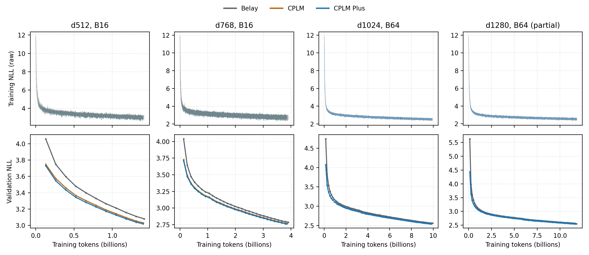

# Belay CPLM Plus

CPLM Plus extends the Belay copy head with predecessor-conditioned keys and
normalized case-class emissions. The backbone, native vocabulary distribution,
COPY/sink mixture, causal mask and packed-document boundaries remain those of
[Belay+CPLM](README.md). This is the two-feature Plus model, not the later
five-feature integration experiment.

## Copy distribution

For source position s, the copy key is
`k_s = h_s W_key + gain * (h_(s-1) W_prev)`.
The predecessor is zero at sequence and document starts. `gain` starts at zero;
the new matrix uses an independent random stream so the original backbone and
copy parameters retain their initialization.

A source emits its exact token with probability `1 - alpha`, or a token in its
case class with probability `alpha = sigmoid(h_t w_variant + b_variant)`.
Within the class, the existing softcap-10 vocabulary logits define a normalized
distribution. The gate starts at `sigmoid(-3)`. The target-only implementation
sums probability over every matching source and agrees with the independent
full-vocabulary oracle in `test_plus.py`.

Classes depend only on the frozen tokenizer. Decode byte-level BPE pieces,
strip leading ASCII spaces then underscores, and lowercase nonempty ASCII
alphanumeric strings containing a letter. Other pieces are singletons. A class
has at most 12 members; a larger class raises an error. The launcher records a
hash of both tables in `case-classes.json` and checks the tokenizer hashes
against `tokenizer_identity.json`.

Compared with ordinary CPLM, Plus adds `d² + 2d + 1` parameters (263,169 at
d512, 591,361 at d768). It adds one predecessor projection and at most 12
vocabulary-column evaluations per target. The class tables use `13 V` int32
entries (about 6.36 MiB at V=128256). Query tiling bounds attention-score
storage; arithmetic is still quadratic in context length. The added parameters
and tables are replicated in the existing shard-map head. Plus introduces no
expert-routing collective, but retains the base head's replication and gradient
reduction costs. It does not implement generation or KV-cache decoding.

## Archived ladder

These are historical native-training results recovered on 2026-10-25, with
seed 0, S=8192, Llama-3.1 vocabulary 128256 and the frozen July data mixture.
The eight completed endpoints have matching W&B steps and GCS
`final_eval_done.json` markers.
They are distinct from the later Belay Ckpt 1 reproduction with vocabulary
16384. Paloma and Uncheatable columns are macro BPB, lower is better.

| Width / layers | Batch | Model | Completed updates | Paloma | Uncheatable |
|---|---:|---|---:|---:|---:|
| 512 / 6 | 16 | Belay | 10,790 | 1.202185 | 0.977077 |
| 512 / 6 | 16 | CPLM | 10,699 | 1.184407 | 0.960857 |
| 512 / 6 | 16 | Plus | 10,676 | 1.181649 | 0.953552 |
| 768 / 8 | 16 | Belay | 29,799 | 1.100180 | 0.859477 |
| 768 / 8 | 16 | CPLM | 29,452 | 1.093305 | 0.853946 |
| 768 / 8 | 16 | Plus | 29,343 | 1.091306 | 0.850160 |
| 1024 / 12 | 64 | Belay | 18,975 | 1.021640 | 0.772050 |
| 1024 / 12 | 64 | Plus | 18,779 | 1.014601 | 0.767052 |

The d512/d768 comparisons ran on v4-32 (16 physical chips); d1024/d1280 used
v4-64 (32 chips). EP=1 and gradient accumulation=1. Within each rung, schedules
approximately match an analytical useful-FLOP budget, not token counts or
measured executed FLOPs. The maximum deviation from the reference budget is
0.22% for the small rungs and 0.13% for the large rungs. These estimates omit
runtime overhead and do not establish equal wall time or a speed improvement.
There is one seed per configuration. No ordinary-CPLM d1024 endpoint was found.

The d1280 rung is incomplete: Belay stopped after 22,499 of 33,724 updates;
Plus stopped after 22,600 of 33,317 updates. Their latest recorded validation
values are intermediate results, not final matched-budget endpoints. All
retrieved d1280 continuation attempts were interrupted. A W&B state of
`finished` without training/evaluation metrics is not counted as completion.



Each line is one recorded execution, without smoothing. The six small-rung
curves contain all logged steps, including the verified d768 continuations
forwarded into their canonical records. Large-rung attempts are plotted
separately, retaining overlapping steps after checkpoint rollback and gaps
between attempts. The d1280 panels are partial. Validation NLL is the recorded
aggregate `eval/loss`, distinct from the macro BPB table above.

[Endpoint data](ladder/results.json) contains the completed-run aggregate
metrics. The raw per-execution histories, full configuration manifest and
checkpoint locations are retained in the research workspace, outside this
public contribution.

The small rungs used the
[frozen native source](https://github.com/WhenWen/marin/tree/0c079e8fbb1d80bf051e5d56a4d5e7a44b780aa7)
and [compute protocol](https://github.com/WhenWen/astra-d8-research/blob/427241e3/research/belay-compute-six-protocol.md).
The large rungs used separate memory and checkpoint execution changes recorded
in the [launch receipts](https://github.com/WhenWen/astra-d8-research/blob/427241e3/research/belay-large-v4-64/launch-receipts.json).
The model implementation here is ported from the small-rung source; these
results do not claim a new end-to-end run of this exact PR revision. In
particular, this port does not include the historical Zarr writer/resume code or
the full large-rung launch harness.

## Launcher and checks

The existing launcher accepts `--variant belay|cplm|plus`, `--width 512|768` and
`--steps N`. For a d512 Plus schedule use `--variant plus --width 512 --steps
10676`; d768 Plus uses `--width 768 --steps 29343`. All other required flags,
tokenizer access and TPU job setup are described in the [base recipe](README.md).
Set the endpoint explicitly: the historical ordinary-CPLM calibration default
remains 10980. The CLI supports the two small rungs; it does not launch the
large-rung execution configuration.

Before optimizer updates, the launcher checks the BF16 fused head's loss and
VJP against dense vocabulary evaluation, then checks full-model finite
gradients. The initially zero predecessor-matrix gradient is expected because
the predecessor gain starts at zero. Case tables are bound for the lifetime of
one run process and shared by training and evaluation.

The non-training numerical checks are:

```bash
uv run pytest -n 0 experiments/grug/moe_cplm/test_head.py \
  experiments/grug/moe_cplm/test_plus.py
```

The dense oracle checks normalization, target NLL, all parameter gradients,
causality and document isolation. CPU checks use the dense vocabulary path;
they do not validate TPU compilation, throughput or checkpoint restoration.
All 11 numerical/tokenizer tests passed on remote CPU with Python 3.12.11 and
JAX 0.11.1. No optimizer updates were executed for this PR's checks.

Research links: [predecessor keys](https://github.com/WhenWen/astra-d8-research/issues/230),
[case-class emissions](https://github.com/WhenWen/astra-d8-research/issues/220),
and [Belay TPU execution](https://github.com/WhenWen/astra-d8-research/issues/236).
