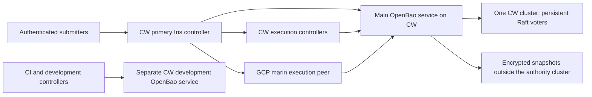

# OpenBao on CoreWeave

This project mocks a CoreWeave-hosted credential authority shared by Iris's
CoreWeave and GCP execution clusters. It renders Kubernetes resources and
OpenBao policy payloads offline. Its Pulumi program can declare the server
resources after the prerequisites below are provisioned. It does not initialize
OpenBao, apply its policies, change existing Iris configs, or implement an Iris
OpenBao client. Keep the PR in draft until those integration decisions are reviewed.

CoreWeave supplies the authority's compute, disks and network under the allocation
expected to last through October 2027; confirm its exact end date before cutover.
The proposed primary submission controller is `cw-us-east-02a`. GCP's `marin`
controller becomes its federated TPU/CPU execution peer. The existing job and
credential implementations continue to run unchanged until an explicit cutover.

## Topology and trust



One OpenBao service contains one data set and Raft quorum. Its servers stay
inside one CW Kubernetes cluster. Consumers in other clusters authenticate to
that service; they do not join its Raft quorum. An OpenBao namespace per execution
cluster scopes its controller login, workload entities and token revocations.
Namespaces share server administrators and outage risk. Main and development
use separate server deployments, CA keys, unseal shares and secret data.

| Service | Host | Bootstrap | Qualified target | Consumers |
| --- | --- | --- | --- | --- |
| Main | `cw-us-east-02a`, `openbao-main` | One sealed server | Five voters on five reserved CPU nodes | `cw-us-east-02a`, `cw-us-east-08a`, `cw-rno2a`, `marin` |
| Development | `cw-us-west-04a`, `openbao-dev` | One sealed server | Three voters on three reserved CPU nodes | `cw-us-west-04a`, `marin-dev` |

These placements and capacity are proposed, not verified inventory. The current
east02 Iris config declares four CPU nodes. Five reserved main voters therefore
require a reviewed pool allocation; the mock does not assume those hosts exist.
The required `marin.community/authority=main` or `=dev` node label and matching
`NoSchedule` taint must be installed on a reserved pool before deployment.
Keep both Bao and the primary controller off hosts that run privileged training
tasks. A taint alone cannot constrain a caller allowed to create arbitrary Pods
or privileged workloads; use admission/RBAC and a separate management cluster
if the cluster cannot enforce the pool boundary. Kubernetes administrators,
cert-manager administrators and the host provider remain trusted.

The existing Iris controller ClusterRole allows Pod creation and exec across
namespaces. A controller in Bao's host cluster is therefore inside the vault's
trust boundary. Use a dedicated management CKS cluster if execution controllers
must be unable to control vault Pods; a separate namespace alone cannot enforce
that separation.

Do not stretch Raft across CW regions or into GCP. Losing the main CW cluster
stops new secret acquisition across its consumers. GCP retains its workload
scheduler and any credentials still valid; it gains no emergency vault authority.
An independent regional service is an alternative if that outage dependency is
unacceptable. It would need separately provisioned secrets, policies, backups and
cloud trust. There is no assumed cross-service replication or automatic fallback.

## Render the mock

From the repository root, using the existing environment:

```bash
uv run --no-sync python infra/openbao/mock.py \
  --stack-file infra/openbao/Pulumi.dev.yaml \
  --catalog-file infra/openbao/catalog.dev.yaml \
  --output /tmp/iris-on-demand-credentials/openbao-dev
```

Use the `main` files for the main service. `kubernetes.yaml` contains the proposed
server resources. `catalog.json` contains per-namespace KV mount, policy and role
API bodies, plus alias prerequisites. Neither output contains credential values.
The mock catalog grants one synthetic model-download reference. It is not a
production entitlement inventory.

Both stacks start with `exposure: internal` and `replicas: 1`. The advertised
hostname is a proposed endpoint until DNS and external routing are enabled.
The image is OpenBao 2.7.1 pinned by its official multi-platform digest. The
`block` storage class is a candidate: verify that it exists, supports the target
hosts, and provides suitable fsync latency, attachment recovery and reclaim
behavior. Raft requires durable per-server storage; shared filesystems or local
scratch are not substitutes without qualification.

## IaC ownership and preview

| Owner | Changes |
| --- | --- |
| `infra/openbao` | Main/dev namespaces, server ServiceAccounts, cert-manager objects, server ConfigMap, headless discovery and API Services, StatefulSet/PVCs, disruption budget, network policy, optional TLS passthrough route |
| `infra/pulumi`, per-CW stacks | Reserved authority pool capacity and scheduling restrictions; existing cert-manager and Traefik prerequisites; future controller bootstrap identity wiring |
| `infra/pulumi`, `marin` stack | Any GCP IAM, workload federation and allowlisted service-account impersonation grants; retain sole ownership of project, secret, KMS and bucket IAM |
| Existing CW DNS/network owner | `bao.oa.dev` and `bao-dev.oa.dev` records targeting the host cluster's ingress; review the primary-controller endpoint and GCP machine-to-machine route |
| Future protected Bao configuration reconciler | Namespaces, auth mounts, entities/aliases, fixed policies and token roles; trusted security-administration authority |
| Operators and secret owners | Initialization, unseal custody, initial auth bindings, audit setup, out-of-band secret population and recovery drills |

This mock adds no GCP VMs, GCP KMS seal key, Google identity provider, cloud grant,
DNS record, node label or existing controller rollout. Pulumi still uses the
repository's GCS state and KMS secrets provider. Those are deployment-tooling
dependencies; an already initialized and unsealed Bao server does not call
them to start or issue tokens. GCP controller authentication and GCP resources
still depend on Google identity services.

The checked-in CW controller still names its Iris signing key and principal
directory in GCP Secret Manager. A full CW trust-root cutover must provision
those bootstrap inputs as controller-only CW Secret/file references too. This
mock does not move their values. Generate new signing material through a reviewed
operator ceremony and retain the previous public keys for existing sessions and
peers; do not strand multi-week jobs. Bao's own startup, TLS and unseal must never
depend on a secret stored inside the sealed vault. Organizational human login
can still depend on Google even when the service authority is hosted on CW.

After review and prerequisite provisioning, preview from the project directory:

```bash
cd infra/openbao
pulumi preview --stack dev --diff
```

Use the operator's reviewed `KUBECONFIG`; the provider binds it to the committed
Iris cluster context and never serializes kubeconfig content. No cloud or cluster
credentials are required for the offline renderer. A live preview requires the
existing Pulumi backend, ambient kubeconfig and installed provider plugins.

The resource group is protected against deletion. StatefulSet PVC retention is
`Retain` on deletion and scale-down. Check the underlying PV reclaim policy too;
PVC retention is not a backup. Pulumi skips readiness waiting because the first
server intentionally starts sealed. A successful update therefore does not mean
the vault is healthy or initialized. No `pulumi up` is part of this mock review.

## Bootstrap, TLS and recovery

The mock uses Shamir unseal with no external seal plugin. Initialize only
`openbao-0`, using five shares and a threshold of three, encrypted to separate
custodians' keys. Store shares outside CW and outside the vault. Never put them,
the initialization root token, TLS private keys or application secrets in Pulumi
config, state, rendered manifests, Iris state, logs or job bundles.

The namespace-local cert-manager issuer creates a private CA and leaf certificate
covering the proposed public hostname and the headless Service's Pod names.
Secret values are generated by cert-manager, not read by Pulumi. Back up this CA
key under a separate custody policy or restore with a new CA and explicitly
redistribute trust. Clients receive only the verified public CA bundle. The
listener automatically reloads changed leaf files; test renewal before adoption.
CA rotation requires overlapping client trust and a leaf replacement procedure.

For a development ceremony, use a TLS-verifying Pod connection or port-forward,
with the public CA and an explicit TLS server name matching the certificate.
`bao operator init -key-shares=5 -key-threshold=3` is the initialization operation;
use the CLI's PGP options and approved custody procedure for its output. Supply
unseal shares through its interactive input, never argv. Do not put initialization
or unseal operations in a Kubernetes Job or CI step.

Enable audit recording and protected administrator authentication, then revoke
the initialization root token. Create the execution-cluster namespaces, JWT
mounts, workload entities and token-mount aliases. Only then apply the rendered
policy bodies. Audit requires two independently monitored destinations: if every
enabled destination fails, OpenBao may refuse requests. A local stdout sink
alone is not a retained audit service.

Increase the StatefulSet size to three or five only after the first server is
initialized. Extra processes start sealed. Join each with `bao operator raft
join` against the initialized leader, unseal with the same shares, and verify
Raft membership, voter health and applied-index convergence before joining the
next. Never initialize a follower independently. There is no automatic
`retry_join` in this mock. `OnDelete` updates require operators to replace and
unseal one process at a time while preserving quorum. Sealed processes have no
liveness restart loop. These choices make manual unseal visible; unattended
recovery requires a separately reviewed CW/offline/HSM auto-unseal design.

Before production, implement an external backup job with a narrowly scoped
root-namespace snapshot identity, separate from config CI. Export encrypted Raft
snapshots at least every five minutes to storage outside the host cluster, using
dedicated writer permissions. A CW object-store destination avoids making GCP
the live authority; it still shares a provider failure domain. A second-provider
copy needs an explicit data-location and transfer decision. Snapshot export can
read the whole encrypted vault and is privileged. Retain tested snapshots and
custodian shares; neither disk replication nor an empty backup bucket is recovery.

Targets are five-minute RPO and four-hour RTO, pending a measured restore drill.
Fence the old endpoint before recovery. Restore in isolation, reapply current
policy, revoke restored controller token trees and reconcile the persisted queue
of pending accessor revocations that the runtime integration must implement
before publishing the recovered service. Replacing secrets with older
snapshot versions must not silently reinstate revoked grants. Record who owns
on-call, snapshots, audits, certificate renewal and upgrades before use.

## API exposure across clusters

After initialization, audit and denial checks, set `exposure: tls-passthrough`
and provision the reviewed DNS record. Traefik's `IngressRouteTCP` forwards SNI
traffic on `websecure` to Bao port 8200 with TLS passthrough. Clients verify the
private CA and hostname all the way to Bao. There is no IAP hop or plaintext
proxy-to-vault connection. Port 8201 is reachable only among Bao Pods in the same
namespace. [Traefik TLS passthrough](https://doc.traefik.io/traefik/reference/routing-configuration/kubernetes/crd/tcp/ingressroutetcp/)

The client Service sends traffic only to unsealed ready servers. The headless
Service deliberately publishes sealed servers for joining. Standbys forward
requests with `disable_standby_reads=true`; test leader loss and all-sealed
behavior on the selected release. The policy allows same-namespace Raft traffic,
the local Iris controller, and the existing Traefik Pods. Outbound HTTPS supports
public JWT key discovery; DNS permits kube-system resolvers. Validate these
policies against CKS's actual CNI and node-local DNS before deployment.

No IP or ingress header conveys a user identity. Audit may record the ingress
address; there is no source-IP authorization claim or PROXY-protocol requirement
in this mock. Every login needs a verified workload JWT and exact auth role.
Do not expose the endpoint with an uninitialized or unaudited service. All
consumers need a bounded retry strategy for unavailable or sealed endpoints.

## Iris as a delegation client

Bao owns the credential policy and issues bounded service tokens. Iris still
decides who submitted a job, which profile the job may use, and whether its exact
attempt is active. A credential profile names a fixed set of readable KV objects.
A logical secret reference selects an operator-cataloged object for delivery;
it does not grant permission by itself. A task cannot select a Bao role, entity
alias, policy or arbitrary vault path. This mock's catalog is operator-owned.

Each execution cluster gets its own Bao namespace and controller JWT auth mount.
For CW, bind the verified Kubernetes issuer/JWKS, exact controller ServiceAccount
subject and dedicated projected-token audience. For GCP, bind Google's issuer,
verification keys, exact numeric controller ServiceAccount subject and dedicated
audience. Deleting and recreating the account changes its numeric subject.
Discover and verify those real values before making a role usable. The rendered
`controller_jwt_role_parameters` intentionally lacks those bindings and is
incomplete by itself. No controller auth mount is applied automatically.

Controllers log in inside their namespace. They receive only named token-create
paths and namespace-local accessor revocation. They receive no KV reads, auth
configuration, policy writes, entity writes, arbitrary token creation or root
namespace rights. Task service tokens have no default policy, are non-orphan,
non-renewable, and expire within ten minutes. Each token role requires an exact
pre-created profile alias on the namespace's **token auth mount**, not its JWT
mount. The controller policy requires that alias on every create call to avoid
inheriting the controller's own entity.

Execution controllers remain trusted to assert submitter and active-attempt
state within their assigned namespace. Moving the root service to CW does not
make a compromised GCP peer harmless. The main reconciler must give that peer
only the profiles and secret copies intended for GCP workloads, with no namespace
administration or cross-cluster issuer trust.

Create workload entities without user, controller or ancestor-group policies.
Never merge, delete or recreate them in ordinary reconciliation; future cloud
federation may use their stable entity IDs. Token creation can implicitly create
a missing alias despite denying `identity/*` writes. Verify the returned entity
ID and unchanged entity inventory before accepting a new catalog revision.

The runtime implementation still needs this sequence:

1. Admission authenticates the submitter, approves profile and references, and
   persists its decision separately from user input. Child/federated grants can
   only narrow it; the receiving execution cluster applies its own policy.
2. A task-local helper proves its exact attempt to its execution controller over
   verified TLS. Do not reuse a capability distributed to log/upload containers
   while claiming helper-only access.
3. The controller rechecks the live attempt and catalog revision, then creates
   the fixed-role child token. Its parent login must have more than ten minutes
   plus clock allowance remaining. Refresh the parent first otherwise.
4. After issuance, persist namespace, accessor, attempt-session generation and effective expiry,
   then recheck state before delivering the bearer into private runtime files.
   Compute effective expiry as the minimum of parent and returned child expiry;
   parent expiry revokes children even if Bao reports a longer child TTL.
5. The helper reads only the profile's requested objects and exposes private
   files to the application. It requests replacements through Iris, not a Bao
   renewal API. Existing environments and SDK caches need explicit reload or
   refreshable providers.
6. Cancellation and entitlement removal stop issuance and persist revocation
   work. Reconcile accessor revocations after restart. A completed revocation
   means Bao acknowledged it; it does not erase copied static API keys or revoke
   independently issued cloud credentials.

Controllers should obtain a new twenty-minute parent login every five minutes,
without revoking old parents until their children expire. Tasks using Iris's
`SANDBOX` container security profile receive no vault identity or helper. Reject
workload network profiles that cannot reach their execution controller and the
Bao API required for their helper's direct reads.
The catalog's fixed profile is the security boundary: selecting fewer references
or pinning a KV version does not narrow a broader readable object's vault policy.

The existing CW storage broker and Iris task-session tokens remain the runtime
implementation in this branch. There is no new ignored `openbao:` job/config
field. Reuse the existing `EnvironmentSpec.secrets` and private-file delivery
for application material. Further work must wire approved vault references,
admission, helper delivery, token accessors, revocation persistence and GCP worker
isolation; a submitted secret value is not a vault reference or authorization grant.
Use native provider federation for storage after separate refresh/permission
probes; do not assume Bao's AWS engine works against CW S3.

## CW primary and GCP peer

The existing federation protocol can reverse submission direction. It hands whole
root jobs to a peer, preserves verified submitter provenance, and lets the peer
own scheduling, retries and task sessions. GCP keeps its controller and worker
fleet; it does not become a remotely driven CW backend. See
[Iris federation](../../lib/iris/docs/federation.md).

The proposed primary's outbound config uses the existing schema:

```yaml
# Proposed changes to cw-us-east-02a; not applied by this project.
peers:
  marin:
    controller_address: https://iris.oa.dev
    cluster: marin
  cw-us-east-08a:
    controller_address: https://iris-cw-us-east-08a.oa.dev
    cluster: cw-us-east-08a
  cw-rno2a:
    controller_address: https://iris-cw-rno2a.oa.dev
    cluster: cw-rno2a
```

Every receiver must add the CW primary's real public verification key to
`auth.federation_peers` and explicitly configure `auth.allowed_submitters`.
No private signing key moves between controllers. GCP's current IAP frontend
requires an edge credential in addition to Iris's federation token. The existing
federation client preserves the peer manifest's IAP provider on
`Proxy-Authorization` while sending the federation bearer on `Authorization`.
Provision and test a noninteractive edge identity for the CW controller before
using that route; an operator's cached browser login is insufficient. A dedicated
TLS machine endpoint protected by Iris federation JWT validation and firewall
rules is an alternative. A new peer entry alone does not provision either route.

The current CW ingress admits GCP egress IPs only. A primary human submission
endpoint needs verified human login, caller roles and protection from anonymous
CIDR admin. Bao OIDC login or direct organizational OIDC is a separate Iris
authentication integration; Bao service tokens are not Iris RPC tokens. Keep
`trusted_cidrs`/anonymous-admin compatibility out of the new authority path.
Review cross-CW source allowlists and user networking before opening it.

Remove GCP's old outbound parent routes at cutover to avoid cycles and duplicate
default routing. Keep explicit cluster IDs; migrate `iris.oa.dev` and client
defaults only after a canary confirms routing in both directions needed by child
jobs. New submissions may switch to CW while existing multi-week roots stay on
their owning controller. Keep its state, keys, endpoint and refresh access until
those jobs and descendants finish. Never transplant its database or invalidate
its task sessions to change the default entry point.

## Review and deployment gates

The mock has no automatic deploy workflow. Before any live use, verify reserved
node isolation, storage durability, TLS trust/renewal, signed workload identities,
auth-role bindings, both audit destinations and an off-cluster restore. Exercise
wrong audience/issuer, wrong alias/profile, missing alias, another tenant's KV
object, stale attempt, child privilege expansion and federation impersonation.
Run a real Bao API probe to check policy behavior, not only rendered JSON.

The runtime integration must survive several token lifetimes, controller restart,
parent rotation, cancellation, task retry, leader loss and network partition.
Check synthetic secret markers against submitted specs, database, manifests,
bundles, logs, crash output and Pulumi state. Credential failure must not restore
shared keys. Load-test peak starts and refreshes, including the approximately
20,000 live task tokens implied by 10,000 attempts refreshing every five minutes.

Main cutover requires an operating owner, custodian coverage for manual unseal,
an agreed regional-outage window, a tested GCP machine route and human login at
the CW primary. Start with one non-production static-secret workload per backend.
Record a migration date before the one-year CW allocation ends, with enough time
to rehearse a restore elsewhere. Replacing free compute still requires preserving
vault data, unseal custody, public trust, provider subjects and controller state.

References: [OpenBao Raft](https://openbao.org/docs/configuration/storage/raft/),
[TLS listener](https://openbao.org/docs/configuration/listener/tcp/),
[token roles](https://openbao.org/docs/api/auth/token/),
[namespaces](https://openbao.org/docs/concepts/namespaces/),
[seal and recovery](https://openbao.org/docs/concepts/seal/),
[Pulumi ownership](../pulumi.md).
