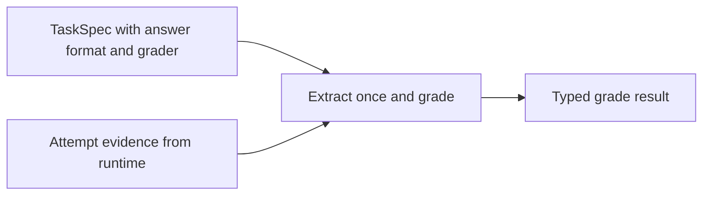

# TaskCompendium

The [task curation pipeline](../../docs/references/task-curation.md) downloads pinned sources, normalizes tasks, runs grading checks and GLM review, then writes final filtering decisions to sharded Parquet. Its audit retains every selected input, source locator, edit and rejection reason. Dataset declarations in the experiment name the pinned source, converter, rubric and grader controls; `taskcompendium.convert` holds the conversion techniques they share.

For ingestion work, start with the [pipeline overview](src/taskcompendium/pipeline/README.md)
and the [experiment flow](../../experiments/post_training/task_curation/README.md).
The sections below describe the task model and its presentation and grading contracts.

## What problem does it solve?

TaskCompendium stores a task's semantic contract, extracts one final submission with the task's answer format, and grades it with the task's grader. Expected answers, grader configuration, and verifier resources stay out of the model request.

Actor execution, model requests, tool dispatch, and actor environment lifecycle belong to the caller’s runtime. `taskcompendium.runtime` grades in a fresh Shellbox machine when the grader needs one. RolloutEngine provides the actor runtime; see [task rollouts](../../docs/references/task-rollouts.md). TaskCompendium does not depend on RolloutEngine.

## What does it contain?

- **Task specs** describe source problems, required capabilities, final results, answer formats, and graders.
- **Answer formats** describe how to request and extract a result, such as plain text, a JSON answer, or a final function call.
- **Typed evidence** records the conversation and an acquired text, JSON, action, or environment-state submission.
- **Grading** scores the extracted evidence in process or in a fresh grading machine, or reports that the task cannot be graded here.



## Protected shared graders

The native Harbor package adapters in `taskcompendium.harbor` prepare new,
versioned tasks for grading in the actor's container. `shared_package.harden_shared_swe`
protects Verifyit pytest graders and source-declared native language runners.
`shared_source.harden_shared_source` preserves the original Scale-SWE,
SWE-Lego, or SWE-rebench source scorer behind the same UID boundary. Callers
supply the original package files and an explicit `SharedDependencyState`.
These helpers do not import dataset declarations or the Atlas trial executor.
Harbor runs the declared initialization command before actor access. The source
adapter authorizes Git access to the declared workspace during that setup,
because its build layer has already assigned the workspace to the actor UID.
Use a Harbor build with task schema 1.3 support. Private bootstrap inputs are stored in a
root-only image directory. Harbor applies the declared actor UID before actor
commands. A runner that ignores initialization cannot read those inputs as the actor. Different
private inputs produce different image contexts; generated images must stay private.

Bootstrap saves private verifier files and a trusted test reference in a
root-owned directory. The actor runs as UID 10001 and cannot read that private
material. Grading stops actor processes, restores the reference, runs tests as
UID 10002, and writes the final report as root. Product files and permitted
dependencies stay mutable. The published integrity contract records dependency
changes, startup hooks, and known gaps; it does not promise isolation from all
candidate-produced output or interpreter startup hooks.

Prime source adapters grant dependency writes only to each task Python's
purelib and platlib directories. The root control interpreter and standard
library stay read-only to the actor. Bootstrap rejects a control runtime or
ancestor that the actor can modify.

`shared_reference.harden_shared_swe_reference` compiles a previously captured
trusted reference into a new package. The reference binds the source package,
image context, controller, and declared actor environment. Keep source tests,
patches, and captured references private; publish a new dataset version and
qualify its original oracle and NoP controls after any adapter change.

Portable package regressions run with the normal affected-test runner.
`tests/test_shared_pytest.py`, `tests/test_shared_source.py`, and
`tests/test_shared_native.py` also execute real Linux UID transitions. Run them
only inside an isolated Linux container as root, with pytest, pytest-json-report,
pip, setuptools, and each selected native toolchain installed. These suites use
the `docker` marker and run in the dedicated `shared-grader-unit` CPU workflow.
Invoke their explicit file paths with `-m docker -o addopts=--import-mode=importlib`
to run that isolated matrix, and run native
projects only when their declared tools are installed. `--shared-source-python`
selects a pytest-capable source interpreter; `--shared-verifyit-source` selects
a pinned legacy Verifyit source directory for the single-manifest regression.
The suite uses synthetic patches and tests and includes actor read-denial checks.

RST and Multi-SWE retain a root actor and require a separate Harbor entry point
for grading-time private delivery. Their adapters are outside this package path.

## Evaluation corpora

`taskcompendium.evaluation.spec` defines `EvaluationProtocol` (schema version 3),
`EvaluationItem`, operation kinds, and consumer summary semantics.
`taskcompendium.evaluation.corpus` verifies and reads published corpora;
`taskcompendium.evaluation.selection` selects cohorts using projected task tags
and labels, ordered groups, and tokenizer-dependent context budgets. Dataset
declarations supply source-specific groups and budget parameters.
`taskcompendium.pipeline.evaluation` publishes the full pinned population with
conversion provenance and shard hashes. These metadata schemas are independent
of the TaskSpec schema below.

Evaluation adapters live under `taskcompendium.importers` and
`taskcompendium.convert`. Reusable Evalchemy benchmark modules and source graders
live in `taskcompendium.importers.evalchemy`. Experiment-owned `EvaluationCorpusRecipe` declarations
bind them to acquisition and environment recipes. Verifyit supplies shared
scoring and judge transport; Shellbox isolates executable graders.

`marin.rollouts.evaluation` executes generation and likelihood operations and
writes raw FineStore attempts. Evaldash summary computation and raw-archive
ingestion remain separate work. See [evaluation tasks](../../docs/references/evaluation-tasks.md)
for publication, execution, and retry/resume contracts.

## What is a task spec?

`TaskSpec` defines one source task, including its grader and expected values. An importer or author creates it before choosing an execution runtime.

| Field | Meaning |
| --- | --- |
| `id` | Stable identity for this task. |
| `context` | An ordered conversation, optionally ending in an unfinished assistant text message. |
| `environment_requirements` | Required capabilities, pinned initial workspace, and named tool-provider contracts. |
| `final_tools` | An ordered list of functions that terminate a chat. They are not backed by a tool provider. |
| `interaction_tools` | Task-owned function definitions advertised to the agent. |
| `tool_bindings` | Explicit bindings from interaction-tool names to execution behavior; shell bindings identify the command argument. |
| `output_paths` | Absolute submission files or recursive directory roots collected by the runtime, outside private grading mounts. |
| `answer_type` | The semantic result: `text`, `number`, `json`, `file`, `state`, `workspace_state`, or `native_action`. |
| `answer_format` | How the final answer is requested from the model and extracted. See [Answer formats](#answer-formats). |
| `grader` | How an attempt is graded. See [What is a grader?](#what-is-a-grader) |
| `reasoning_markup` | `grade` (default) scores an attempt as usual. `reject` grades an attempt whose model reply has a malformed reasoning span (unclosed, repeated, or a stray closer) as a reward-0 `submission_failure`. Applied by the SkyRL rollout worker before grading results are grouped. |
| `source` | Upstream dataset, revision, row, and importer revision retained as audit provenance. |
| `schema_version` | Version of the serialized spec: `0.31`. Readers upgrade `0.30` and reject other versions. |
| `resources` | Inline files grouped under `all`, `worker`, `oracle`, and `verifier` visibility. |
| `tags` | Arbitrary descriptive strings, retained in order, including duplicates and empty strings. |
| `labels` | String-valued annotations for queries and cohort selection. Tags and labels are also projected into normalized Parquet. |

A task has one final result. TaskSpec does not define ordered task stages or stage-reward aggregation.

Shellbox transfers the regular files selected by `output_paths`, recursively
expanding directories. Missing paths are omitted; explicitly selected symlinks
are rejected and symlinks inside directories are skipped. The runtime limits the
submission to 1,024 files and 16 MiB total, with a per-file limit from its output
budget. Overflow fails the whole transfer. Selections cannot overlap `/tests`,
`/logs/verifier` or `/solution`. The grader receives only declared submission paths.

`ConversationInput.events` is the model-visible conversation prefix. A text event retains its role and content. Historical assistant calls and tool results retain their call IDs and order; a runtime preserves this history when presenting the task to the model. `answer_type` does not prescribe a wrapper such as JSON; `answer_format` does.

Conversation events preserve their declared roles. A runtime harness determines how to use them: ordinary chat requests include completed assistant turns, while an explicitly selected `AssistantPrefixHarness` continues the final assistant text. The serving model chooses its tokenizer; historical token IDs are source provenance.

`ConversationInput` is not a lossless Responses API transcript. It excludes provider reasoning items. The NeMo importer omits an unencrypted historical reasoning summary only when a visible assistant message or function call follows it. It rejects encrypted reasoning and reasoning left at the decision point. Exact provider continuation from reasoning state is outside this contract.

An **answer** is the task’s semantic result, identified by `answer_type`. A **submission** is the typed value the task's answer format extracts from a completed attempt for grading. Different answer formats can yield the same submission and carry the same answer.

For example, a task asking “What is 7 + 5?” can have `answer_type=number` and a `numeric` grader that expects `12`. The `PlainText`, `JsonAnswer`, and `AnswerCall` formats carry that answer as `12`, `{"answer":"12"}`, and a final `submit_answer({"answer":"12"})` call, respectively. Each extracts the string `12` for the same grader, which accepts both `12` and `12.0`. A task asking for a function call has `answer_type=native_action`; its context retains the conversation and its `final_tools` field describes the source functions. The grader and expected answer are never added to the model-visible input. Importers must make source output instructions agree with the task's answer format, or reject rows they cannot safely rewrite. A raw-output requirement in a source message would conflict with `JsonAnswer` or `AnswerCall`; `answer_type=text` alone cannot detect that conflict in prose.

## What can a task represent?

### Text answers

A text task uses `answer_type=text`. `PlainText`, `Boxed`, `JsonAnswer`, and `AnswerCall` can carry its answer. The `exact` mode compares normalized text; `mcq` grades a single option letter. Invalid MCQ option text scores zero through verifyit. Both modes grade the answer extracted by any of these formats.

### Numeric answers

A numeric task uses `answer_type=number` and can use the same answer formats as text. `JsonAnswer` accepts a finite JSON number in its `answer` field and passes its string form to the grader. Expected values are required numeric literal strings, preserving integers, decimals and fractions exactly. Absolute and relative tolerances are required finite nonnegative floats. The `numeric` mode reads the last boxed answer, or exactly one numeric literal from the last nonempty line when no box is present. Surrounding prose, including negation, is ignored. Missing, malformed, or ambiguous numeric output is `submission_failure`; a valid wrong number is `graded` with reward `0.0`.

`taskcompendium.grading.grade_result` maps verifyit rewards to `GradeResult` the same way for in-process grading and for the verdict the verifyit command writes in a grading machine. Malformed numeric text is `submission_failure` with reward `0.0` in both.

### Final function calls

A task whose result is a function call uses `answer_type=native_action` and the `FinalAction` answer format. Its `final_tools` field declares the available functions. `FinalAction` defines whether a call is required and the maximum call count. It extracts the assistant's final message, and the `predicted_action` mode compares the submitted function names and decoded argument objects with the expected calls. Grading compares the submitted calls without dispatching them.

For text and numeric tasks, the `AnswerCall` format adds `submit_answer(answer: string)` alongside the task’s final tools. It extracts the call's `answer` argument and passes it to the task's grader. A non-call response or a call to another function receives `submission_failure` with reward `0.0`.

### Files and state

`answer_type=file` names a file result. `answer_type=workspace_state` names the final filesystem workspace. `answer_type=state` names arbitrary resulting environment state, including provider state outside a filesystem. Acquiring these results requires an actor runtime. These tasks still declare an `answer_format`, but grading does not read it. `file` and `workspace_state` answers require a grader with a placement. In-process grading uses supplied evidence. The TaskCompendium shell runtime captures declared output files. The `structured_exact` mode compares JSON values and ordered arrays. Numbers compare by value by default (`16` equals `16.0`). Booleans remain distinct. Set `numeric_types="strict"` to require exact numeric scalar types.

`answer_type=json` is a JSON answer from the model, independent of environment state. `JsonValueAnswer` parses the complete final chat text into a `JsonSubmission` for `structured_exact`. `StateSubmission` is evidence acquired from an environment by its runtime. `structured_exact` accepts either. The `JsonAnswer` format instead unwraps an `answer` string for text or numeric tasks, or a JSON number for numeric tasks. Both JSON formats accept one Markdown code fence enclosing the whole reply and reject extra prose, duplicate keys at every nesting level, and nonfinite numbers. Tool-call arguments are decoded before entering the conversation evidence. Runtimes own provider-response decoding and may report malformed tool-call arguments as a structural submission failure with reward `0.0`. Both historical and final calls contain typed argument objects.

Public expectations belong in `context`: for example, the columns a CSV must contain or the behavior a repaired project must provide. The grader checks those expectations. The answer format chooses how the result is delivered and extracted. `answer_type` identifies the answer’s semantic kind.

## Environment requirements

`environment_requirements` declares the initial state and operations needed to solve a task.

`command_semantics` describes native Linux processes or a simulated shell.
The caller selects a Shellbox factory; shared runtime preparation checks that it
can satisfy the requirements and binds the image or lock-backed dependencies.
Agent and grader requirements remain separate. Conversation-only tasks need no
command semantics, and missing packaging never implies simulation.

| Field | Meaning |
| --- | --- |
| `capabilities` | Unique operation names, such as `shell`, `network`, `filesystem`, `process`, or `browser`. Names are open so future capabilities can be represented. |
| `command_semantics` | `LINUX_PROCESS` for native execution, `SHELL_SIMULATOR` for the simulated command language and virtual filesystem, or `None` when no shell execution is required. |
| `docker_image` | Optional immutable image reference, such as `registry/project@sha256:<64 lowercase hex digits>`. Tags alone are rejected. |
| `docker_build` | Optional `DockerBuildContext(files=...)` containing inline regular files relative to the build-context root, including `Dockerfile`. Backends that support builds build it when they create the machine. |
| `working_directory` | Optional normalized absolute POSIX path for the main workspace. Omission declares no required working directory. |
| `setup_commands` | Ordered commands required to establish the initial workspace. |
| `environment_variables` | String values required in the worker or grading machine environment. |
| `tool_providers` | Mapping from a task-local provider instance name to a required action interface and initial state. |
| `packages_lock` | Storage URL of an artifact-backed, hash-pinned Python requirements lock. Current runtime preparation supports these through Shellbox local. |
| `services` | Sidecar containers sharing the task's network and lifetime: a pinned image or build context, working directory, variables, entrypoint and command overrides, named TCP endpoints addressed as `<service>:<port>`, and a readiness check. The primary environment is the agent's container. Omitted from serialization when empty. |
| `readiness` | A command the primary environment must pass, with per-attempt and overall timeouts, interval, start period and attempt limit, before the agent starts. Omitted from serialization when unset. |

Each `ProviderRequirement` contains `action_interface`, a versioned contract name such as `workplace:v1`, and required `initial_state`, a JSON value such as a string, null, or an object. Two named instances can require the same interface with different initial states. No digest is required. The selected runtime owns provider implementation, transport, state initialization, reset, and tool execution. `final_tools` contains only ordered function definitions advertised at the final decision point; it supplies no implementation.

The task's environment and worker file mounts describe worker initial state. A grader that runs in its own machine has a `GraderMachine` placement, which declares that machine's image or build recipe, capabilities, setup commands, and environment variables in `grader.placement.environment`. A grader environment requires a `docker_image`, `docker_build`, `package_spec`, or local `packages_lock`, and cannot declare tool providers. Runtimes keep those requirements and verifier resources separate from the worker environment. A grader with an `AgentMachine` placement runs in the worker's machine after the agent finishes and declares no environment of its own.

`docker_image`, `docker_build`, and `packages_lock` are mutually exclusive.
Build files preserve bytes, modes and timestamps; paths cannot collide. Resource
budgets count actor and grader contexts separately. Dockerfile contexts are built
online by backends that support builds: RolloutEngine passes the context to the
selected backend as a `shellbox.image.DockerfileSource`, and a backend that cannot
build rejects it with `UnsupportedMachineSpec` before any machine starts.
`taskcompendium.runtime` accepts a build context only with a `DockerfileSource`
machine spec. All three dependency forms require `LINUX_PROCESS` semantics. The
SAMPLE/FULL control machines admit only pinned images and package environments.
Runtime preparation rejects `services` and `readiness` until a runtime creates
multi-container Shellbox tasks.
Native requirements without packaging remain representable but cannot execute
through the current adapters. Memory settings are advisory sizing hints.

The [Harbor exporter](../../experiments/post_training/task_curation/tasktrove/harbor_export.py) emits build inputs;
see the [campaign quickstart](../../experiments/post_training/task_curation/README.md#harbor-compatibility-view)
for execution limits.

## Resource mounts

`resources` is a `ResourceGroups` object. Each group contains an ordered list of `TaskResource` mounts.

| Group | Visibility |
| --- | --- |
| `all` | Shared inputs visible to the worker, oracle, and grader. |
| `worker` | Model-visible inputs. |
| `oracle` | Reference material for oracle controls, hidden from the model. |
| `verifier` | Grader inputs, hidden from the model. |

Gold answers and hidden tests belong in `oracle` or `verifier`. An `all` resource is model-visible. A role receives `all` followed by its own mounts. Destinations must be distinct in that combined sequence and have no file/directory ancestor collisions. Names retain POSIX case distinctions. Separate role-specific groups can reuse a relative path without sharing their content.

Oracle resources are reserved for trusted reference-solution generation. Verifier resources are used when evaluating a candidate result. These groups declare access; they do not require an oracle or evaluator process to run.

The TaskCompendium and RolloutEngine runtimes install shared, worker, and oracle resources at `/<path>`: a resource at `app/project/input.txt` appears at `/app/project/input.txt`. Worker mounts are established before setup commands run. A grading machine receives verifier resources at `/tests/<path>`; in-process modes read them by that relative path.

Each `TaskResource` contains one inline file, with these fields:

| Field | Meaning |
| --- | --- |
| `path` | Normalized relative destination: `/<path>` for shared, worker, and oracle resources, and `/tests/<path>` for verifier resources. |
| `source` | An `InlineFile` containing the exact file bytes, encoded as canonical base64. |
| `mode` | Optional Unix permission mode as a three- or four-digit octal string, such as `0644` or `0755`. An explicit mode applies to the mounted file. Files default to `0644` when the mode is omitted. |
| `mtime_ns` | Optional integer Unix modification timestamp in nanoseconds for the mounted file. Omission leaves the timestamp unspecified. |

`InlineFile` has `kind="inline_file"` and `content_base64`. UTF-8 text uses the same byte representation as binary files. Resource contents are stored in the task spec; no dataset root or process working directory is used to locate them. Shared external files are deferred until a `TaskSet` contract defines their location and loading.

An archive can be included as ordinary file bytes, but resource mounting does not extract it. Paths may contain directories to locate the file within the workspace. Directory resources and recursive copies are unsupported. Schema decoding performs no filesystem inspection or I/O.

Grouped inline resources can contain:

```json
{
  "resources": {
    "all": [
      {
        "path": "README.txt",
        "source": {"kind": "inline_file", "content_base64": "VXNlIHRoZSBzdXBwbGllZCBwcm9qZWN0Lg=="},
        "mode": "0444",
        "mtime_ns": 1725555600000000000
      }
    ],
    "worker": [
      {"path": "project/input.txt", "source": {"kind": "inline_file", "content_base64": "cHVibGljIGlucHV0"}}
    ],
    "oracle": [
      {"path": "answer.txt", "source": {"kind": "inline_file", "content_base64": "cHJpdmF0ZSByZWZlcmVuY2U="}}
    ],
    "verifier": [
      {"path": "checks/grade.py", "source": {"kind": "inline_file", "content_base64": "cHJpdmF0ZSBjaGVja3M="}}
    ]
  }
}
```

File materializers must reject unsafe destinations and collisions, and enforce byte limits. The schema and in-process grading do not materialize resources. Execution runtimes supply mounts and role isolation; `grade_in_sandbox` stages grading inputs into a fresh machine.

## What can we import?

### Harbor task packages

`taskcompendium.importers.harbor` lowers a Harbor task package without importing Harbor.
`image_references(directory)` lists every external image the package needs: the prebuilt
image, each Dockerfile `FROM` and `COPY --from` image, Compose sidecar images, and the separate
verifier's image or `tests/Dockerfile` bases. `resolve_image_digests` reads their current
digests with `skopeo`. `lower_package(directory, task_id=..., source=..., rule=..., image_digests=...)`
returns a `HarborTask` holding the `TaskSpec` and its `EpisodeInputs`.

| Package part | TaskSpec |
| --- | --- |
| `instruction.md` | One user message. |
| `[environment].docker_image` | `docker_image` pinned as `name:tag@sha256:...`; extra `environment/` files are worker resources under `[environment].workdir`. |
| `environment/Dockerfile` | `docker_build` with every external `FROM` and `COPY --from` image pinned. A `FROM` naming a global `ARG` uses its default. |
| `environment/docker-compose.yaml` | `services` for the sidecars, with endpoints and readiness from `expose` and `healthcheck`. HTTP MCP servers served by a sidecar become `mcp:v1` tool providers. |
| `[environment]` `env`, `workdir`, `healthcheck`, `allow_internet` | Variables, working directory (else the Dockerfile's final `WORKDIR`), `readiness`, and the `network` capability. |
| `[agent].timeout_sec`, `[verifier].timeout_sec`, `cpus`, `memory_mb`, `storage_mb` | `EpisodeInputs`, with `network` from `allow_internet`. |
| `tests/`, `solution/`, `setup_files/` | Verifier resources at `/tests`, oracle resources at `/solution`, worker resources at `/setup_files`, with mode 0755 or 0644 from the executable bit. |
| `[metadata]` `category`, `difficulty`, `tags` | Labels, with `harbor_path` naming the package directory. |

A Compose file may instead override only `main`, as Harbor's Docker backends expect. Harbor merges
it after its own base files and fills its placeholders, so the importer drops `main` settings that
restate Harbor's own: a build of `.` or `${CONTEXT_DIR}`, the `${MAIN_IMAGE_NAME}` tag, the
`sleep infinity` command, the `${HOST_*_PATH}:${ENV_*_PATH}` log mounts, `TEST_DIR=${TEST_DIR}`,
which Harbor never sets, and `deploy.resources.limits` of `${CPUS}` and `${MEMORY}`, which Harbor
fills from `cpus` and `memory_mb`. `network_mode` `bridge` or `${NETWORK_MODE:-bridge}` is the
default network; `none` denies network access. The remaining `environment` entries become the
agent machine's variables. Other values, such as literal resource limits or another network mode,
are rejected.

A variable whose whole value is `${NAME}` or `${NAME:-default}` stays a template; the runtime
resolves it from its host environment when it creates the machine. `host_variables` in
`taskcompendium.runtime.environment` names the variables a requirement reads, and curated
evaluation runs supply each from secret references (see
[evaluation tasks](../../docs/references/evaluation-tasks.md)).

The dataset's grading rule selects the grader. `PackageTests` runs `bash /tests/test.sh` and
reads `/logs/verifier/reward.json` (`json_metrics`) or `reward.txt`, with `answer_type=workspace_state`.
Harbor's default shared verifier becomes a `ScriptGrader` with an `AgentMachine` placement, run in
the agent's working directory with `[verifier].env`; a shared verifier with collect hooks or with
variables that read host values (`${NAME}`) is rejected. A separate verifier becomes a
`GraderMachine` placement whose machine comes from `[verifier.environment]` or `tests/`, with
collect hooks, each limited to its `timeout_sec`, and `/logs/artifacts` copied over.
`AnswerFile(path, grader)` captures one file with `answer_type=file` and grades its text on the host with a `VerifyitGrader` that has no placement.
`package_grader` is the single place these choices are made.

`UnsupportedHarborFeature.reason` explains a package the importer will not lower: multi-step
tasks, GPUs or TPUs, non-Linux tasks, non-root agent or verifier users, collect hooks with their
own users, agent skills, MCP servers no sidecar serves, unresolvable `ARG` bases, and Compose
settings outside the supported subset. A dataset converter records it as an unsupported-row
rejection.

### NeMo predicted function calls

`taskcompendium.importers.nemo_predicted_action.import_row` accepts a NeMo predicted-function-call row and a caller-pinned digest of that row. `taskcompendium.identity.canonical_sha256(row)` hashes its UTF-8 JSON with sorted keys and compact separators; record the digest with the source revision before importing. The importer returns a TaskSpec with `answer_type=native_action` and a `FinalAction` answer format. The context carries the source conversation; `final_tools` carries advertised functions. `FinalAction.require_call` is set when the source requires a tool call, and `FinalAction.max_calls=1` when the source disables parallel calls. The expected function calls stay in the `predicted_action` grader. There is one stored conversation, with no second flattened prompt to keep in sync.

The runtime presents the source turns and function definitions and retains the final response as typed evidence. The grader compares submitted function names and JSON arguments. The importer rejects rows whose expected action is an assistant text message because the source comparator gives any message full credit; it also rejects request settings it cannot carry. The pinned fixture records the NeMo Gym repository revision and blob SHA in `tests/fixtures/nemo/predicted-action.provenance.json`. Numeric tolerance is used only when explicitly set in the grader's parameters.

## What is a grader?

`TaskSpec.grader` declares how an attempt is graded. Its `kind` field selects one of three classes in `taskcompendium.models`:

| `kind` | Class | Grading |
| --- | --- | --- |
| `verifyit` | `VerifyitGrader` | A stock verifyit `mode` and its `parameters`: the keys of verifyit's `verifier.toml` table other than `mode`. |
| `script` | `ScriptGrader` | A command run after the attempt in the machine its placement selects. |
| `none` | `NoGrader` | The task cannot be graded here. `reason` says why; `contract` optionally keeps the source's grading terms. |

A `VerifyitGrader` without a `placement` grades the extracted answer in process; for a `file` answer with exactly one output path, the answer is the captured file's UTF-8 text, and a missing or undecodable file is a submission failure. Its mode must be one of `verifyit.candidate.IN_PROCESS_MODES`: `exact`, `numeric`, `mcq`, `math`, `ifeval`, `json-schema`, `xml-elements`, `csv-columns`, `structured_exact`, `structure_closure`, `reasoning_markup`, or `predicted_action`. `reasoning_markup` grades the final assistant message's text, including the text before its function calls, and scores one when its reasoning markup is well formed; the attempt's stop reason excuses a span left open by a length stop. A `VerifyitGrader` with a `placement` runs the verifyit command in that machine, with verifier resources under `/tests` and the verifyit specification at `/tests/verifier.toml`. Modes that execute code, such as `pytest` and `stdio`, grade only there. `grade_task` and RolloutEngine grade a `judge` grader on the host, through its judge service (`grade_remote_judge_answer`). Construction validates `parameters` with verifyit.

A `ScriptGrader` declares:

| Field | Meaning |
| --- | --- |
| `argv`, `cwd`, `env` | The grader command, its working directory (default `/app`; `None` keeps the machine's own, such as an image's `WORKDIR`), and added environment variables. |
| `placement` | Where the command runs: `AgentMachine()` or `GraderMachine(environment, collect, artifacts)`. |
| `answer_path` | Where the extracted answer is written (default `/app/answer.txt`): text as text, JSON as JSON, and a final action as the final assistant message's JSON. |
| `conversation_path` | Where the conversation is written as OpenAI-style chat messages in JSON (default `/tests/conversation.json`). |
| `reward` | `StdoutReward` (default), `ExitCodeReward`, or `FileReward`. |
| `empty_output` | `ZERO` rejects an empty extracted answer; `GRADE` passes it to the script. |
| `judge` | Optional `JudgeSpec` declaring the model service required by the script. |
| `timeout` | Deadline in seconds for each grading command (default 600), or the complete operation when `replay` is present. |
| `replay` | Optional `ReplayStage` that executes captured files in a separate machine before grading its declared outputs. |

`StdoutReward` requires exit code 0 and one finite number on standard output; anything else is `infra_error`. `ExitCodeReward` scores 1.0 for exit code 0 and 0.0 otherwise. `FileReward.files` lists candidate reward files in priority order; the first that exists supplies the score. Each `RewardFile` holds a number, or a JSON object whose `key` (default `reward`) holds the score and whose optional `detail` object becomes the grade detail. A `json_metrics` file is a flat object whose `key` holds the score and whose other members, all finite numbers, become the grade detail. `FileReward.pass_above` sets `GradeResult.passed`; `ExitCodeReward` sets it from the exit code. A missing, empty, or invalid reward file is `infra_error`. A timed-out command is `infra_error` for every reward source.

A grader placement is one of two models in `taskcompendium.models`:

| `kind` | Class | Grading machine |
| --- | --- | --- |
| `agent_machine` | `AgentMachine` | The agent's machine, after the harness ends. The grader sees every file and change the agent left, and the machine's network policy applies. Verifier resources, the conversation and the extracted answer are staged as root, and `/logs/verifier` is emptied, before the command runs. |
| `grader_machine` | `GraderMachine` | A fresh machine built from `environment`. Agent state reaches it only through captured `output_paths`, `collect` commands run as root on the agent's machine, each within its `timeout` and the grader's limit, and `artifacts` copied from the agent's machine with exclusions and a missing-file policy. |

`RewardFileFormat.VERDICT_JSON` reads Verifyit's structured `reward`, `status`
and `detail` fields. It preserves unscored infrastructure failures and invalid
tasks, including their diagnostic details. The command must exit successfully.
This format retains named metrics and reduction inputs in `detail`.

A scripted judge receives its declared specification at `/tests/judge.toml`.
The caller supplies `JudgeConnection` separately; the runtime puts credentials
only in the grading command's environment: the verifier machine's, or for an
`AgentMachine` placement, the command's own. Task serialization and staged
archives exclude those credentials. The machine must permit network access.

For file and workspace answers, `ReplayStage` declares a prepared, digest-pinned
`environment`, an `argv` command, `cwd`, command `timeout`, and output `artifacts`.
Replay receives shared and worker resources, its declared helper `resources`,
and captured submission files. Replay helpers must contain no references or secrets;
they are not installed in the actor or grader. Replay
receives neither oracle/verifier resources nor inherited machine environment
variables or judge credentials. Its image, explicit environment, and helper resources must be
audited for the same separation. Replay closes before the grading machine starts;
only declared replay outputs are transferred, with the usual archive size and
symlink checks. The original submitted program is not transferred to grading.
Output formats must also be safe for the grader to decode: replay isolation does
not make a candidate-produced pickle safe to load alongside references.

Candidate execution failure scores zero; setup and total-deadline failures are
ungraded infrastructure errors. Missing outputs follow each artifact's policy.
Replay cannot be combined with `answer_path`, `collect`, or actor `artifacts`.

TaskSpec validation ties the grader to the answer:

- An in-process `VerifyitGrader` cannot grade `file` or `workspace_state` answers.
- A `VerifyitGrader` with a placement cannot grade `native_action` answers. Its workspace modes (`stdio`, `pytest`, `junit`, and `gotest`) cannot grade `text`, `number`, or `json` answers.
- `ScriptGrader.answer_path` must be `None` for `file`, `state`, and `workspace_state` answers. `conversation_path` must not replace a verifier resource.
- Answer paths, output paths, and output directories must lie outside `/tests` and `/logs/verifier`.

A `NoGrader` task grades as `unavailable`, with no reward and its `reason` as the error. Converters use `NoGrader` when the source evaluator needs a runtime this repository cannot provide; its `contract` records the evaluator, source revision, grading data and runtime requirements. `taskcompendium.grader.grader_config(task)` returns a copy of a `NoGrader`'s contract, or the `config.json` verifier resource of another grader.

`taskcompendium.grader.GraderPackage` pairs a grader with its verifier resources, whose paths are relative to `/tests`. `verifyit_package(spec, resources=(), placement=None)` builds a `VerifyitGrader` from a verifyit `Spec`. Build other packages directly with `GraderPackage(grader, resources)`.

```python
from taskcompendium.grader import verifyit_package
from verifyit.spec import ExactSpec, FunctionCall, McqSpec, PredictedActionSpec, StructuredExactSpec

text_grader = verifyit_package(ExactSpec(expected=("expected text",))).grader
mcq_grader = verifyit_package(McqSpec(expected="C", options=4)).grader
json_grader = verifyit_package(StructuredExactSpec(expected={"value": 16})).grader
action_grader = verifyit_package(
    PredictedActionSpec(expected_calls=(FunctionCall(name="lookup", arguments={"city": "Paris"}),))
).grader
```

A grader scores one acquired answer. Comparative scoring across several attempts, cohort membership, and grading phase belong to the trainer. Standard grading modes and in-process scoring live in `verifyit`; TaskCompendium has no grader registry or separate standard verifier schema.

## Answer formats

`TaskSpec.answer_format` says how the final answer is requested from the model and extracted from `conversation.events[-1]`, the final assistant message or call batch. Earlier events are validated history; historical calls must have their results before the final submission.

| Format | `kind` | Extracts | Answer types |
| --- | --- | --- | --- |
| `PlainText` | `plain_text` | The whole final message | `text`, `number` |
| `Boxed` | `boxed` | The content of the last `\boxed{...}`, else the whole final message | `text`, `number` |
| `JsonAnswer` | `json_answer` | The nonempty string `answer` field of a JSON object, or a JSON number for a `number` task | `text`, `number` |
| `JsonValueAnswer` | `json_value` | The whole final message as one JSON value | `json` |
| `AnswerCall` | `answer_call` | The `answer` argument of one `submit_answer` call | `text`, `number` |
| `FinalAction` | `final_action` | The final message: calls to `final_tools`, or text | `native_action` |

A `text`, `number`, `json`, or `native_action` task must use a format that carries its answer type. `submission_compatibility(task)` also checks that the grader's verifyit mode accepts the submission the format extracts (`TextSubmission`, `JsonSubmission`, or `ActionSubmission`), that a `FinalAction` task has final tools, and that no final tool is named `submit_answer` under `AnswerCall`.

Answer formats preserve the task's advertised functions. `AnswerCall` adds `submit_answer` with an answer string. `FinalAction(require_call=True)` requires a call, and `FinalAction(max_calls=1)` limits the submission to one call. Missing required calls and excessive call counts are `submission_failure` with reward `0.0`.

`taskcompendium.submission` builds model requests from the task alone. `submission_instruction(answer_format)` returns the format's final-answer instruction, and `answer_call_tool()` returns the `submit_answer` tool definition. `chat_request(task)` and `render_instruction(task)` combine them with the public conversation and final tools. These helpers perform no execution.

## Optional terminal ejection

`enable_ejection(task)` adds the reserved `eject_button(reason)` final tool. Use it on
both solvable and unsolvable tasks. Ejection instructions live only in the tool description;
normal answer instructions and parallel-call constraints are preserved.

`mark_unsolvable(task)` privately classifies a confirmed unsolvable direct-chat task. It
returns a new task with the same context and final tools as `enable_ejection(task)`, an
`unsolvable` verifyit grader, and a `FinalAction` answer format. For text and JSON formats,
`FinalAction.normal_submission` retains the original model-facing answer instructions and
tools. Native-action tasks retain their required-call and maximum-call constraints.
Callers must establish unsolvability; unsupported runtimes and missing evidence do not
establish it. The helper rejects tasks that cannot already run and be graded in direct chat.

```python
from taskcompendium.ejection import enable_ejection, mark_unsolvable

solvable = enable_ejection(task)
confirmed_unsolvable = mark_unsolvable(task)
```

Both tasks produce identical `chat_request` and `render_instruction` output. The grader and
expected answers remain private. A valid ejection is one terminal call with a nonempty string
`reason`. Its call ID and reason remain in an `ActionSubmission`; the reason's prose is not
scored. Ejection earns reward `1.0` only for the private `unsolvable` mode and `0.0` otherwise.
Normal answers to unsolvable tasks earn `0.0`. Malformed reasons, mixed ejection/answer calls,
unadvertised ejections, and continuation after ejection are `submission_failure` with reward
`0.0`. Completed ejection calls in the source conversation are historical input.

`answer_submission` dispatches ejection before the normal answer-format extractor, without
passing expected answers or solvability labels into extraction.

Generate paired missing-information, contradictory-constraint, and guideline examples as
serialized TaskSpecs:

```bash
uv run --package marin-taskcompendium python -m taskcompendium.examples.ejection \
  /tmp/ejection-tasks --pairs-per-family 32
```

This produces 192 tasks. The example generates task definitions; no model performance
evaluation is included.

## Grading

Create a task:

```python
from taskcompendium.grader import verifyit_package
from taskcompendium.models import (
    AnswerType,
    ConversationInput,
    EnvironmentRequirements,
    PlainText,
    Source,
    TaskSpec,
    TextMessage,
)
from verifyit.spec import NumericSpec

spec = TaskSpec(
    id="arithmetic-7-plus-5",
    context=ConversationInput(events=(TextMessage(role="user", content="What is 7 + 5?"),)),
    environment_requirements=EnvironmentRequirements(),
    answer_type=AnswerType.NUMBER,
    answer_format=PlainText(),
    grader=verifyit_package(NumericSpec(expected="12", tolerance_abs=0.0, tolerance_rel=0.0)).grader,
    source=Source(dataset="hand-authored", revision="2026-09-16", row="arithmetic-7-plus-5", importer_revision="1"),
)
```

After execution, the caller supplies the complete conversation to `GradingAttempt`:

```python
from taskcompendium.grading import grade_answer
from taskcompendium.models import ConversationTrace, GradingAttempt

def score_final_response(content: str):
    conversation = ConversationTrace(
        events=(*spec.context.events, TextMessage(role="assistant", content=content))
    )
    return grade_answer(spec, GradingAttempt(conversation))
```

Three functions grade an attempt:

- `taskcompendium.grading.grade_answer(task, attempt)` grades with an in-process `VerifyitGrader`. The answer format extracts the submission, or `attempt.state` supplies it for a `state` answer, and `verifyit.candidate.grade_candidate` scores it. It raises `TypeError` for other graders.
- `taskcompendium.runtime.grading.grade_in_sandbox(task, attempt, factory, machine_spec, *, task_machine=None, timeout=None)` is asynchronous. It grades with a `GraderMachine` placement in a fresh machine from `factory`. `task_machine` is the agent's machine, required for `collect` and `artifacts`. Machine exceptions propagate.
- `taskcompendium.runtime.grading.grade_in_agent_machine(task, attempt, task_machine, *, timeout=None)` is asynchronous. It grades with an `AgentMachine` placement in the agent's machine after its harness has returned. Machine exceptions propagate.
- `taskcompendium.runtime.task_grading.grade_task(task, attempt, *, machine_factory=None, machine_spec=None, judge_connection=None)` grades any task synchronously. A `NoGrader` task is `unavailable`. A judge grader uses `grade_remote_judge_answer` with `judge_connection`; an in-process grader uses `grade_answer`; a `GraderMachine` grader uses shared environment preparation and `grade_in_sandbox`; an `AgentMachine` grader is `infra_error`, because its machine ended with the attempt. Unsupported requirements raise before machine creation. A missing factory or machine specification, and machine `RuntimeError` or `OSError`, become `infra_error`.

RolloutEngine calls `grade_answer`, `grade_remote_judge_answer`, `grade_in_sandbox`, or `grade_in_agent_machine` after the harness ends; see [task rollouts](../../docs/references/task-rollouts.md).

The execution runtime completes file and environment-state acquisition before grading. `GradingAttempt` carries the conversation, captured file bytes keyed by absolute path, and an optional `StateSubmission`. A missing state is `None`; captured JSON null is `StateSubmission(None)`. `taskcompendium.runtime.models.grading_attempt(conversation, evidence)` builds an attempt from captured `RuntimeEvidence`. A grading machine also receives a conversational answer extracted from the conversation. Expected values remain in `task.grader` and verifier resources and must not be included in the model request.

A valid correct answer produces `GradeResult(status=graded, reward=1.0)`; a valid wrong answer produces `graded` with reward `0.0`. A final message the answer format cannot read, and numeric text the `numeric` mode cannot read, produce `submission_failure` with reward `0.0`. verifyit's `invalid_task` and `infra_error` statuses carry no reward and stay separate from wrong or invalid submissions. `grade_answer` raises when the answer format is incompatible with the grader.

Execution runtimes decode provider responses into `TextMessage` or `AssistantToolCalls` before constructing a `ConversationTrace`. Tool-call arguments must be decoded JSON objects. A runtime may expose malformed provider output as `submission_failure` with reward `0.0`; network and execution errors remain separate.

## Dataset conversion

TaskSpec defines the serialized task contract. Dataset conversion pipelines own storage layout and streaming I/O, using Zephyr for Parquet processing. The optional `taskcompendium.pipeline` package stores curation outputs through Zephyr. See [pipeline contracts](src/taskcompendium/pipeline/README.md). JSON decoding preserves valid requirements independently of a runtime's support for them.

```python
serialized = spec.model_dump_json()
restored = TaskSpec.model_validate_json(serialized)
```

The serialized spec includes the grader configuration and verifier resources. Store it where trusted grading code can read it; build model requests with `chat_request(task)` or `render_instruction(task)`, which read only the public context, final tools, and answer format.

### ScienceAgentBench Verified conversion

`taskcompendium.importers.scienceagentbench.VERIFIED_SOURCE` pins the released
Verified annotation Parquet and rejects missing, duplicated, or unexpected task
IDs before yielding rows. `actor_context` constructs knowledge-on/off inputs
from explicit public fields, preserving complete instructions and previews.
Raw annotations contain reference metadata and must not be mounted for actors;
image preparation must also check knowledge-off isolation.

`scienceagentbench_task` combines one annotation with a prepared actor environment,
a replay-enabled `GraderPackage`, and the private reference program. It captures
only `/testbed/solution.py` and requires the same environment for actor and replay.
An oracle control can copy `/controls/reference.py` to `/testbed/solution.py` and
then use ordinary grading. The reference is staged only for oracle controls.

`scienceagentbench_grading.deterministic_grader` packages a source evaluator
with the common output wrapper. The grader image supplies the source's private
gold files and required data. Source data/shape errors remain failed submissions;
missing gold files, dependencies, and other runtime failures remain ungraded.
Reference validation must reject any package whose own gold data or evaluator
produces these errors before the package can be used for model scoring.

Task 22 uses `papyrus_grader`. Replay executes the submitted program and decodes
its pickle without gold data or credentials, then transfers normalized JSON rows.
Trusted preparation separately normalizes the pinned gold pickle with the same
decoder. The scorer reads only JSON arrays of strings, with a 1,048,576-character
row limit. It preserves the upstream sort/round/string conversion and gold-prefix
comparison, including the upstream acceptance of matching rows followed by extras.
The package transfers neither the candidate pickle nor the decoder to grading. Validation
must use the pinned scientific environment; synthetic local tests establish the
transfer and scoring behavior, not full benchmark or container validation.

This module is not registered as a runnable evaluation. Preparing the real images
and visual grader packages, validating references, and official Pi/EvalDash integration
remain tracked in
[issue #11592](https://github.com/marin-community/marin/issues/11592).

## Development

TaskCompendium requires Python 3.12 or 3.13 and uses `marin-rigging` for relative POSIX path and mount-collision validation. Resource names preserve Linux semantics, including colons, backslashes, trailing spaces, and case distinctions. Absolute paths, traversal, NUL bytes, duplicate files, and file/directory collisions are rejected. The validator leaf module performs no storage access.

TaskCompendium uses the root workspace's `uv.lock` and `.venv`. Run the package tests from the repository root:

```bash
uv run --package marin-taskcompendium --extra pipeline --group test pytest lib/taskcompendium/tests -q

# Type-check from the package project directory with its dependencies available.
cd lib/taskcompendium
uvx --from 'pyrefly>=1.0.0,<1.1.0' pyrefly check
```

Schema `0.32` combines explicit grader placement with isolated submitted-program replay.
The reader upgrades both schema `0.30` and the two development layouts of `0.31`.
A grader with a legacy environment receives a fresh grading machine.
Legacy judge settings are upgraded to equivalent candidate steps. Stored corpus bytes and their hashes are preserved.
